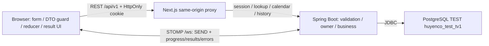

# TV1 Phase 8A kiểm toán Client và ma trận nghiệm thu

Ngày 27/10/2026. Branch `bmanh812`, baseline `c2271405a9f785d8d1e6d83e3404f910a537ff24`. Phase 6 ở `b1e4965`, Phase 7 ở `dc6dda0`; merge main `9905c40` đã hoàn tất trước lượt này. Đây là audit/tài liệu và sửa UI nhỏ, không phải tuyên bố toàn sản phẩm COMPLETE.

## Đối chiếu kế hoạch gốc

Đã đọc bản local `C:\Users\ADMIN\Downloads\HuyenCo_TV1_KeHoach_ChiTiet.docx`, đặc biệt Phase 8/P8 T01–T05 và ma trận kiểm thử. Kế hoạch yêu cầu test sau tích hợp, demo hai phiên, kiểm lỗi/keyboard/mobile, README, kịch bản F01–F08, bằng chứng và kiểm bản sạch. Trong 8A: thực hiện review Client, regression, tài liệu và browser fixture. Chưa thực hiện live H01, thử mất Server thật, benchmark hoặc kiểm máy sạch. Không tự mở thêm tính năng ngoài F01–F08.

Quy ước trạng thái: **IMPLEMENTED** = có code; **MOCK ACCEPTED** = đã kiểm Client bằng mock, không chứng minh nghiệp vụ/ACL thật; **LIVE ACCEPTED** chỉ dùng kèm môi trường/ca thực tế; **BLOCKED** ghi rõ phụ thuộc. Bằng chứng Server trong các biên bản dưới là nghiệm thu Backend được bàn giao, không tự nâng UI TV1 thành LIVE ACCEPTED. Không chạy lại chúng trong 8A.

## Ma trận F01–F09 — cập nhật bằng chứng 8E/8F

Đường dẫn test/code dưới đây tương đối với `client/`; mỗi nhóm đều thuộc full regression của lượt này, không cộng trùng số ca giữa các F.

| F / phần đã làm | Trạng thái Client | Test và file liên quan | Bằng chứng Server có sẵn | Giới hạn / blocker / người làm tiếp |
| --- | --- | --- | --- | --- |
| F01 TIME, gửi offset +07:00, nhận lịch/ba quẻ | **8F LIVE ACCEPTED ca D01**; giữ mock regression 8A riêng | `src/app/mai-hoa/page.tsx`, `page.test.tsx`, `result-flow.test.tsx`, `components/mai-hoa/maiHoaInput.test.ts`, `types/contractValidation.test.ts` | [B04](27-B04-TIME-HANDOFF.md), [chốt chia6](28-TIME-OWNER-APPROVAL.md); fixture TIME runtime và run 8F bên dưới | Quy ước nhóm, UTC+7 cố định; không suy từ ca chuẩn thành mọi đầu vào lịch. |
| F02 OBJECT_COUNT, số vật/giờ Chi độc lập | **8F LIVE ACCEPTED ca 12/8** | `components/mai-hoa/maiHoaInput.ts`, `.test.ts`, `app/mai-hoa/page.test.tsx`, `result-flow.test.tsx` | [B03](21-B03-OBJECT-COUNT-HANDOFF.md), fixture `mai-hoa-object-count`, UI/STOMP 8F | TEAM_DECISION/SOURCE_AMBIGUOUS được giữ trên UI; không gọi công thức nguyên bản đã xác minh. |
| F03 LINES và quẻ chủ/hỗ/biến, hào động | **8F LIVE ACCEPTED ca D03** | `LinesForm`, `linesInput`, `MaiHoaResultView`, `HexagramView` và các test cùng tên | [B01](18-B01-LINES-HANDOFF.md), ví dụ `mai-hoa-lines`, [M03](41-M03-MAI-HOA-INTERPRETATION-HANDOFF.md); UI/STOMP 8F | Hào 1 dưới cùng, ba quẻ và hào động khớp fixture; không chạy lại toàn bộ 384 tổ hợp. |
| F04 Tam Thế CAREER/WEALTH/LOVE, EXTENDED | **8F LIVE ACCEPTED ca D06 đại diện** | `app/tam-the/page.tsx`, `.test.tsx`, `tamTheInput`, `wealthInput`, `results/ReadingResults.test.tsx`, `types/d04Wealth.test.ts` | [D03](30-D03-TAM-THE-HANDOFF.md), [D04](42-D04-TAM-THE-EXTENDED-WEALTH-HANDOFF.md); 720 tổ hợp thuộc bằng chứng Backend riêng | Lộc no-match không có lời luận bù; Sang hèn/Điền sản giữ dữ liệu trả về. Không tuyên bố UI live đủ 720 tổ hợp hoặc LEGACY. |
| F05 tìm/lọc/phân trang/chi tiết 64 quẻ | **8F LIVE ACCEPTED dataset 64 mã phân biệt** | `app/hexagrams/page.tsx`, `.test.tsx`, `HexagramDetailPanel.test.tsx`, `rest/hexagrams.test.ts`, `hexagramValidation.test.ts` | [E02](32-E02-HEXAGRAM-LOOKUP-HANDOFF.md), fixture `hexagram-tinh`; bốn trang thật trong 8F | Đã đi đủ trang, tìm/lọc và mở Tỉnh; NAME_GLOSS không phải lời dự đoán. Không mở riêng chi tiết cả 64 quẻ. |
| F06 đổi lịch hai chiều và Can Chi | **8F LIVE ACCEPTED ca round-trip/Can Chi chuẩn** | `app/calendar/page.tsx`, `components/calendar/*`, `rest/calendar.test.ts`, `calendarValidation.test.ts` | [C01](26-C01-CALENDAR-HANDOFF.md), fixture lịch và bốn POST thật 8F | UTC+7 cố định; chưa kiểm live mọi ngày hoặc mọi tháng nhuận trong miền 1900–2099. |
| F07 progress, timeout/disconnect/reconnect | **8F LIVE ACCEPTED progress/isolation**; fault injection live PENDING | `websocket/useCalculation*.test.ts`, `calculationState.ts`, `ResultPanel.test.tsx`, `scripts/calculation-state.test.mjs` | [B02](20-B02-PROGRESS-HANDOFF.md), [N01](36-N01-CONCURRENCY-IDEMPOTENCY-HANDOFF.md), [V12](43-HUYENCO-V12-DEPLOYMENT-ACCEPTANCE.md); 6 SEND/24 progress/6 terminal 8F | Hai context không nhận lẫn; không SEND lặp. Timeout, late/duplicate terminal và reconnect giữ bằng chứng mock/component riêng, chưa gây lỗi mạng live. |
| F08 bootstrap/save/list/search/detail/delete | 8A: MOCK ACCEPTED; **8E: LIVE ACCEPTED trong phạm vi hai-owner TEST bên dưới** | `app/history/*`, `components/history/HistoryUI.test.tsx`, `rest/history.test.ts`, `session/SessionProvider.test.tsx`, `historyValidation.test.ts`; bằng chứng Playwright live 8E | [H01](34-H01-SESSION-HISTORY-HANDOFF.md) và lượt UI/HTTP/STOMP thật ngày 27/10, run `20261027143334086` | Save/detail/delete, owner GET/DELETE, CSRF và UI đạt. Live pagination nhiều trang, fault injection reconnect và kiểm máy sạch chưa thực hiện; không suy rộng thành toàn sản phẩm DONE. |
| F09 lời luận Mai Hoa M03 | **8F LIVE ACCEPTED hai ca đại diện D04/D05** | `DetailedReadingView`, `readingContract`, guard và test kết quả đã có | [M03](41-M03-MAI-HOA-INTERPRETATION-HANDOFF.md); fixture M03 TIME/GENERAL và LINES/LOVE qua UI/STOMP thật | Thể/Dụng, chiều quan hệ, bốn giai đoạn, mùa/không xét mùa, summary và nguồn/quyết định khớp. Không thay bằng chứng 1536 tổ hợp Backend bằng hai ca UI. |

## Review và sửa tập trung

- Trang chủ còn hai nhãn TIME/Tam Thế “đang phát triển”; thay bằng tên các phương pháp/category hiện có, không gắn nhãn live thành công.
- ResultPanel idle còn thông báo “kiểm tra hợp đồng giao tiếp”; thay bằng hướng dẫn nhập/gửi để xem tiến trình và kết quả. Cập nhật assertion câu chữ tương ứng, giữ kiểm trạng thái kết nối.
- Browser tái hiện tiêu đề history 100 chữ `W` hợp lệ làm `scrollWidth=3242` tại viewport320; thêm `overflow-wrap:anywhere` cho heading của PageHeader. Không đổi dữ liệu hoặc validator để né lỗi.
- Navigation có đủ 6 mục và skip link; detail có link trở lại collection. Không tạo thêm trang hoặc redesign.
- Loading/error/empty, input focus lỗi, nguồn/TEAM_DECISION, REST cancellation và vòng đời STOMP được review theo code/test hiện có. Không đổi API, timer hoặc thuật toán.

## Ma trận lỗi và lifecycle

| Ca | Bằng chứng Client |
| --- | --- |
| INVALID_INPUT, INVALID_DATE, RULE_NOT_AVAILABLE, DATABASE_UNAVAILABLE, SERVER_BUSY, PROCESSING_TIMEOUT | `useCalculation.test.ts` ca “T02 retains matching Server failure”; `contractValidation.test.ts`; lịch có thêm mapping HTTP trong `rest/calendar.test.ts`. |
| INVALID_SESSION, CSRF_REJECTED | `rest/history.test.ts`, `SessionProvider.test.tsx`, `HistoryUI.test.tsx`: không báo thành công, ẩn state riêng tư, không tự retry mutation. |
| Client timeout, late response, duplicate final | `useCalculation.test.ts`, `scripts/calculation-state.test.mjs`: deadline tổng không gia hạn bằng progress, terminal cũ/trùng không ghi đè. |
| Disconnect/reconnect, không resend | `useCalculation.test.ts`, `useCalculation.connection.test.ts`; ca H01 phục hồi session không replay request cũ. |
| Stale REST, unmount, repeated submit | `app/hexagrams/page.test.tsx`, `CalendarForm.test.tsx`, `HistoryUI.test.tsx`, `rest/hexagrams.test.ts`: abort/ignore response cũ; guard pending. |

Đây là test mock/thuần Client. Lượt 8A không gây lỗi trên Server thật hoặc ngắt kết nối của người khác.

## Responsive, accessibility và bằng chứng browser

Kiểm tra bằng preview production cô lập `127.0.0.2:3183`, mock `127.0.0.2:8183`. Session API mock chỉ trả canned DTO, không Set-Cookie/tạo owner/session thật; history POST/DELETE bị chặn. Snapshot là fixture được duyệt; riêng tiêu đề 100 chữ W là ca stress tổng hợp. Không dùng output này để chứng minh công thức, đủ dataset hay ownership.

Kết quả browser 8A:

- **32/32 kiểm tra route × viewport PASS**: tám route nêu trong README tại320,375,768,1440px; không có horizontal overflow hoặc nội dung role=alert tại lúc đo. Trang detail history dùng M03 snapshot cùng tiêu đề stress100 chữ W; không dùng dữ liệu cá nhân.
- Tiêu đề stress sau sửa tại320px: document scrollWidth305px bằng clientWidth305px,heading scrollWidth256px; trước sửa document scrollWidth3242px. Ngắt dòng giữ toàn bộ tiêu đề,không cắt hoặc đổi dữ liệu.
- Skip link nhận focus bằng Tab và có outline rõ. Submit TIME trống báo lỗi,aria-invalid và focus về `maihoa-datetime`. Nhãn input hiển thị đầy đủ.
- Dialog ở375px: focus đầu Hủy → Tab tới Xác nhận xóa → Shift+Tab về Hủy; Escape đóng và trả focus về nút Xóa ban đầu. **Không bấm xác nhận xóa.**
- Tam Thế EXTENDED từ canned STOMP có đủ ba tiểu mục và no-match Lộc; phần lời luận/nguồn nhìn được ở375px. Saved snapshot cùng fixture được kiểm thêm ở320px: scrollWidth=clientWidth305px. Nhập giờ native bằng phím được kiểm; không thay input/validator do hạn chế fill của công cụ.
- Browser console không có warning/error ở lần đọc cuối. Mock stats cuối:36 canned session responses,10 history GET,1 calculation fixture,**0 history mutation requests**. Các response phiên mẫu không tạo cookie,owner,session thật hoặc dòng DB.

Ảnh và helper lưu ngoài repo trong thư mục `visualizations/2026/10/01/01a0f781-cc34-7c43-9631-a90ccb2f9129` của Codex: `huyenco-phase8a-responsive.json`, `huyenco-phase8a-title-before.jpg`, `huyenco-phase8a-title-after.jpg`, `huyenco-phase8a-home-desktop.jpg`, `huyenco-phase8a-validation-mobile.jpg`, `huyenco-phase8a-tam-the-mobile.jpg`, `huyenco-phase8a-dialog-mobile.jpg`. Không đưa screenshot tạm vào commit. Bằng chứng mock lưu/xóa Phase7 thuộc lượt trước;8A không gửi save/delete. Đây là review UI/keyboard,không phải chứng nhận accessibility toàn diện hoặc test ownership thật. Đã reset viewport,đóng tab và dừng hai process mock/preview do lượt8A tạo;không restart Backend.

## Verification cuối

Baseline trước 8A: 1213 Vitest +12 Node =1225 test PASS,62 fixture, typecheck/build PASS.

Kết quả test8A: **35 file Vitest/1213 test PASS**,**12 Node calculation/reducer test PASS**,tổng**1225 PASS/0 failed/0 skipped**;**62 JSON fixture PASS**. Lượt đầu có1 failure do assertion ResultPanel còn tìm câu idle cũ;đã đổi assertion sang câu mới,không xóa test hoặc nới kiểm trạng thái. Lượt full regression kế tiếp PASS toàn bộ;không thêm test logic trùng vì các ca lỗi/lifecycle đã có coverage.

Typecheck cuối: **PASS**. Production build bằng cấu hình thông thường: **PASS**,đủ tám route yêu cầu;diff check của các thay đổi code: **PASS**. Hai build có đích mock chỉ dùng nghiệm thu visual,trong đó build thứ hai sau sửa overflow;không coi chúng là bản production thật. Đã dừng mock trước build cuối,không mở UI nối Backend thật. Các biến mock chỉ đặt trong process kiểm thử,không sửa `.env.local` hoặc cấu hình được track.

## Blocker và bàn giao tiếp

1. Live H01 save/delete và hai-owner TV1: PENDING tại 8A; **đã được nghiệm thu trong phạm vi lượt 8E bên dưới**. Những giới hạn pagination/reconnect/máy sạch vẫn được ghi riêng. Kể cả mở trang thật cũng bootstrap phiên và có thể ghi DB.
2. UI/network F01–F07 chưa nghiệm thu lại ở 8A; **8F đã đóng các ca chuẩn được cấp phép** bên dưới. Network fault injection, các ca ngoài fixture đại diện và nguồn/biên lịch rộng hơn vẫn giữ phạm vi bằng chứng riêng.
3. Cài/chạy trên máy/cấu hình sạch, demo hai browser, gói nộp và bằng chứng báo cáo còn cần thực hiện theo P8 T02/T04/T05. Không có script `test:e2e` trong package hiện tại; không ghi là đã chạy.
4. Không có benchmark mới trong 8A; TV2 cung cấp số đo thật nếu dùng trong báo cáo. Không chạy 739-case E2E/load test để đóng 8A.

Không commit/push 8A. Không đổi Server/DB/fixture gốc; giữ audit artifact untracked có sẵn. README này và kịch bản demo là tài liệu bàn giao để nhóm review, không phải nghiệm thu cuối toàn sản phẩm.

## Bổ sung Phase 8E — preflight live H01, ngày 27/10/2026

Baseline kiểm tra: branch `bmanh812`, HEAD `d95c92651e37f840eb158f284dd1c23056130e9f`. Người dùng đã cho phép một lượt TEST giới hạn: hai phiên độc lập, hai calculation, tối đa hai history record và dọn đúng hai record đó. Phần dưới chỉ ghi những bước thực sự đã chạy; không thay bằng chứng mock hoặc biên bản Server thành kết quả live UI.

| Hạng mục | Kết quả đã xác minh |
| --- | --- |
| Backend TEST hiện hữu | PID `6800`, listener `127.0.0.1:8080`; command line đúng JDBC `jdbc:postgresql://127.0.0.1:5432/huyenco_test_tv1`, role `huyenco_tv1_test`, Flyway tắt. Không restart Backend. |
| Readiness trước lượt | GET `/api/v1/readiness`: HTTP 200; `status=READY`, `database=UP`, `schema=READY`, `seed=READY`. |
| Frontend thật | `npm run dev -- --hostname 127.0.0.1 --port 3173`, Next.js 16.4.2 báo Ready. Đã tạo `.env.local` được Git ignore, chỉ chứa ba URL TEST đã được yêu cầu: WebSocket `ws://127.0.0.1:8080/ws`, API base `/api/v1`, upstream `http://127.0.0.1:8080`. Không chạy mock preview. |
| Hai browser context và network capture | Chưa thực hiện. Browser tool hiện tại không cung cấp context độc lập/network capture cần cho lượt A/B. Đã hỏi người dùng lựa chọn Playwright local nếu có sẵn hoặc thao tác hai trình duyệt thủ công; chưa tự chuyển sang công nghệ UI khác khi chưa có lựa chọn. |
| Session, STOMP, save, ownership, CSRF, cleanup | NOT RUN trong lượt preflight này; chưa tạo session/history hay gửi calculation. Không có history ID nào do lượt này tạo cần dọn. |
| UI/keyboard/mobile | Chưa kiểm live trong lượt này; bằng chứng mock 8A ở trên giữ nguyên phạm vi. Không tuyên bố live pagination. |

**Verdict hiện tại: H01 LIVE ACCEPTANCE PARTIAL — chờ phương thức hai context độc lập và thu bằng chứng HTTP/STOMP. F08 chưa được đánh dấu PASS.** Backend/Frontend được giữ chạy để tiếp tục theo lựa chọn của người dùng. Next.js tự sinh `client/AGENTS.md` và đổi đường dẫn type dev trong `client/next-env.d.ts`; không có sửa logic ứng dụng, migration/import, commit hoặc push.

## Phase 8E tiếp tục — LIVE ACCEPTED với Playwright local

Người dùng đã chọn rõ Playwright local và cấp phép tiếp tục đúng một lượt giới hạn. Kết quả dưới đây thay trạng thái PARTIAL của mốc preflight phía trên; không viết lại kết quả lịch sử 8A. Run `20261027143334086`, ngày 27/10/2026, cùng branch/HEAD ở preflight; Chromium headless `156.0.8078.4`, Playwright `1.62.1` đã có sẵn. Executable Chromium thông thường gặp `spawn UNKNOWN` trước khi mở trang; executable headless-shell đã cài chạy thành công. Không cài/tải dependency hoặc browser, không sửa package/lockfile, không dùng browser profile cá nhân hoặc storageState chung.

Trước khi chạy: Backend PID `6800` đúng datasource/role TEST và Flyway tắt, readiness HTTP 200/READY với database UP/schema READY/seed READY; Frontend PID `30272` trả HTTP 200 và trang Huyền Cơ thật tại `http://127.0.0.1:3173`. Không restart hai ứng dụng, không SQL diagnostic, migration/import hoặc truy cập database được bảo vệ.

| Nhóm kiểm live | Kết quả xác minh |
| --- | --- |
| Context/session | Hai `browser.newContext()` riêng, không chia cookie jar. Mỗi context bootstrap ban đầu một lần, HTTP 200/envelope hợp lệ. Các lần tải lại detail bootstrap lại cùng cookie; không tạo owner thay thế. WebSocket của mỗi context mở sau session bootstrap. |
| Cookie/proxy/owner handshake | Cookie `huyenco_session`: HttpOnly, SameSite=Lax, Path=/; Secure=false phù hợp HTTP loopback. Không đọc/in cookie value. Session qua Next same-origin proxy; STOMP trực tiếp cùng hostname. Việc lưu được đúng kết quả owned và kiểm owner chéo là bằng chứng tích hợp cookie/handshake/proxy, không phải kiểm bằng cách xuất raw header. |
| A — Mai Hoa | D03/`mai-hoa-lines.request.json`: sáu hào `[true,false,true,false,true,false]`, động 2. Đúng một SEND, bốn progress đúng thứ tự được render, đúng một COMPLETED. Ba quẻ/code/sáu hào khớp fixture; rule/source metadata có trong kết quả. |
| B — Tam Thế | D06 từ kịch bản 45: Âm lịch 1984-02-01, 08:30, không nhuận, cả ba category, EXTENDED. Đúng một SEND, bốn progress render, một COMPLETED; toàn bộ data khớp `d04-wealth-no-loc.response.json`. Đây là input fixture tổng hợp, không phải dữ liệu cá nhân. |
| Save A/B | Bấm lưu trên UI sau COMPLETED, tiêu đề `TV1-H01-20261027143334086-A-MAI` / `TV1-H01-20261027143334086-B-TAM`; cả hai HTTP 201. Bấm đôi chỉ phát một POST/context. Body chỉ có `calculationRequestId,title`, không ownerId/result snapshot. Tổng đúng hai history record. |
| Snapshot/list/detail | Cả hai snapshot lưu và đọc lại khớp toàn bộ result STOMP khi so sánh object không phụ thuộc thứ tự key; đúng history type. List đúng một record/owner; tìm tiêu đề, lọc cùng type, lọc ngược type ra rỗng đều đạt. UI detail hiển thị snapshot đúng loại, không phát calculation mới. Loading được quan sát qua DOM thật. |
| Owner GET | B đọc ID A và A đọc ID B: đều HTTP 404/NOT_FOUND. Chỉ dùng đúng hai ID tạo trong run. |
| Owner DELETE | Hai chiều chéo owner, dùng session/CSRF hợp lệ của bên thực hiện và Origin thật: đều HTTP 404/NOT_FOUND. Record gốc vẫn đọc được bởi owner, snapshot không đổi. |
| CSRF | DELETE ID A bằng session A nhưng thiếu CSRF hoặc token không hợp lệ: đều HTTP 403/CSRF_REJECTED; record A vẫn còn. Không tắt Origin/CSRF hoặc giả danh owner. |
| Error UI | A mở chính ID B của run, Server 404 và UI hiển thị lỗi Không tìm thấy. Có một console resource 404 mong đợi do ca này, không coi là lỗi bất ngờ. |
| Dialog/keyboard/mobile | A/B: focus đầu vào Hủy, Tab chuyển/trap trong dialog, Escape đóng và trả focus về nút Xóa; Hủy không phát DELETE. Dialog 375px không clip/tràn; detail A/B có scrollWidth=viewport=375. Đã kiểm ảnh detail desktop, dialog mobile và bố cục trang mobile. Không coi đây là kiểm toàn diện accessibility. |
| Cleanup qua UI | Owner A xác nhận xóa A, owner B xác nhận xóa B: HTTP 200 với deleted=true. Sau mỗi lần, detail HTTP 404/NOT_FOUND, tìm đúng tiêu đề trả 0 mục và UI hiện danh sách trống. **Hai record đã xóa, không còn record history nào do run tạo.** Không SQL cleanup, không xóa session rows hoặc record khác. |
| Privacy/errors | Không tìm thấy giá trị CSRF của hai phiên hoặc mẫu raw session cookie trong log Backend đã kiểm. SessionProvider giữ CSRF trong React memory; không thấy key cookie/CSRF trong local/session storage của hai context mới. Không lưu HAR, trace, storageState hoặc credential. Không pageerror; ngoài resource 404 chủ động ở A, không console error bất ngờ. |

Lượt này ghi **22 nhóm bằng chứng**, không phải số lượng test Vitest/unit mới. Một selector helper ban đầu tìm `role=alert` trùng Next route announcer; đã thu hẹp về `main`, không sửa source sản phẩm và không lặp calculation/save.

Bằng chứng ngoài repo: thư mục `C:\Users\ADMIN\.codex\visualizations\2026\10\01\01a0f781-cc34-7c43-9631-a90ccb2f9129`, file `huyenco-phase8e-20261027143334086.json`; ảnh cùng prefix `huyenco-phase8e-20261027143334086-` gồm A/B saved, detail desktop/mobile, dialog mobile, cleanup mobile và A-cross-owner-error. JSON chỉ chứa status/code/count/ID của record TEST/metadata kiểm, không cookie/CSRF/password; không đưa artifact vào Git.

Giới hạn: một record mỗi owner nên **chưa nghiệm thu live pagination nhiều trang**; giữ bằng chứng mock 8A/Phase 7 riêng. Không gây reconnect hoặc mất Server trong run; mỗi context chỉ gửi một calculation, không quan sát thấy resend, kiểm fault injection vẫn là task riêng. F01 TIME/F02 OBJECT_COUNT, các ca Tam Thế khác, tra cứu quẻ/lịch/Can Chi và UI/network đầy đủ F01–F07, benchmark/tải và máy sạch chưa được đóng bằng lượt H01 này. Các bài test npm đã báo ở 8A không được chạy lại và không được tính là kết quả mới của 8E.

**Verdict: H01 LIVE ACCEPTANCE PASS — F08 LIVE ACCEPTED trong phạm vi các ca bắt buộc hai-owner/save/detail/delete/CSRF trên TEST.** Đã đóng Chromium/context tạm và xóa CSRF khỏi biến helper; Backend/Frontend giữ chạy. Chỉ cập nhật tài liệu nghiệm thu, giữ nguyên thay đổi local sẵn có và artifact audit; không sửa source để ép PASS, không commit/push.

## Phase 8F — live UI/network F01–F07 và M03/D04 đại diện

Ngày **27/10/2026**, người kiểm: Codex/Playwright theo quyền người dùng; run `20261027145705907`. Git: `bmanh812`, HEAD `d95c92651e37f840eb158f284dd1c23056130e9f`. Giữ toàn bộ sửa tài liệu 8E, `next-env.d.ts`, `client/AGENTS.md` và artifact audit có sẵn. Không sửa source, fixture, package hoặc lockfile.

Môi trường đã xác minh trước khi tạo session: Backend PID `6800`, `127.0.0.1:8080`, datasource `jdbc:postgresql://127.0.0.1:5432/huyenco_test_tv1`, role `huyenco_tv1_test`, Flyway disabled; readiness HTTP 200/READY, database UP, schema READY, seed READY. Frontend thật PID `30272`, `http://127.0.0.1:3173`, HTTP 200. Playwright local `1.62.1`, Chromium headless-shell `156.0.8078.4` đã cài; không tải/cài tooling, không restart hai ứng dụng.

Hai browser context mới tách cookie jar, mỗi context bootstrap một phiên bằng POST session HTTP 200 trước khi WebSocket kết nối. Chỉ chọn thuộc tính cookie để kiểm HttpOnly/SameSite=Lax/Path=/, không lấy/in value; CSRF chỉ giữ tạm trong memory helper để kiểm rò log rồi xóa. Không profile cá nhân, shared storageState, HAR hoặc trace. Có guard chặn POST/DELETE history nếu vô tình phát sinh; **không có request chạm guard, không có truy cập history**, không dùng response giả hoặc mock HTTP/STOMP.

| Ca | Expected theo fixture/hợp đồng | Actual UI/network | Kết quả |
| --- | --- | --- | --- |
| F01 / D01 TIME | `mai-hoa-time.request/response`: 2024-02-10T00:00:00+07:00, không detailed reading | Request payload và toàn bộ response data khớp fixture; ba quẻ/sáu hào/hào động đúng; metadata/các bước tính giữ nguyên | PASS — LIVE ACCEPTED ca chuẩn |
| F02 / D02 OBJECT_COUNT | `mai-hoa-object-count.*`: objectCount12, hourIndex8, động2; TEAM_DECISION/SOURCE_AMBIGUOUS | Toàn bộ request/data khớp. UI summary ghi “Theo quy ước nhóm”, “Nguồn còn điểm cần đối chiếu”, không đổi trạng thái tổng thành VERIFIED | PASS — LIVE ACCEPTED ca chuẩn |
| F03 / D03 LINES | `mai-hoa-lines.*`: `[true,false,true,false,true,false]`, động2 | Request/data khớp; DOM ba figure đều theo thứ tự hào6→1 từ trên xuống, dương/âm đúng; chỉ hào2 quẻ chủ được highlight; source cards có thật | PASS — LIVE ACCEPTED ca chuẩn |
| F09 / D04 M03 TIME GENERAL | `m03-time-reading.*` | Request/data khớp toàn bộ; Thể/Dụng, quan hệ có chiều, bốn phase và nội dung, summary khớp; mở nguồn giai đoạn1/nguồn tổng hợp, giữ quyết định; thời điểm UI chỉ là datetime mùa từ Server | PASS — LIVE ACCEPTED đại diện |
| F09 / D05 M03 LINES LOVE | `m03-lines-reading.*`, không context datetime | Request/data khớp toàn bộ; bốn phase/nội dung/chiều quan hệ/summary đúng; mùa NOT_EVALUATED, không có time element tự thêm, có cảnh báo không lấy giờ hiện tại | PASS — LIVE ACCEPTED đại diện |
| F04 / D06 Tam Thế EXTENDED | `d04-wealth-no-loc.*`, Âm1984-02-01/08:30, không nhuận, ba category | Request/data khớp; CAREER/WEALTH/LOVE render, Lộc no-match có0 interpretation-entry và ghi rõ không bổ sung lời luận; Sang hèn/Điền sản giữ entry hợp lệ, metadata nguyên vẹn | PASS — LIVE ACCEPTED đại diện |
| F05 / D07 toàn bộ trang | Dataset64, size20, không thiếu/trùng, thứ tự code ổn định | Bốn GET trang UI:20/20/20/4; mỗi bộ code trên UI khớp response. Tổng64 code,64 phân biệt; prev/next, biên đầu/cuối và quay lại trang3 đúng | PASS — LIVE ACCEPTED phân trang thư viện quẻ |
| F05 / D07 tìm/lọc/detail | Code `H_KHAM_TON`, tên `Tỉnh`; thượng KHAM/hạ TON; `hexagram-tinh.response` | Tên/mã ra đúng1; upper-only8, lower-only8, kết hợp1. Detail HTTP200/data khớp toàn bộ fixture, sáu hào đúng; tên Tỉnh, gloss Giếng nước, nhãn in Ích và ghi chú nguồn được giữ; có disclaimer không phải lời dự đoán | PASS — LIVE ACCEPTED ca detail |
| F06 / D08 round-trip | `calendar-convert.*`: Dương2000-01-01 ↔ Âm25/11/1999, không nhuận | Hai POST UI thật HTTP200; chiều xuôi khớp request/data fixture, chiều ngược input LUNAR đúng và toàn bộ result bằng chiều xuôi, không dùng response mock cố định | PASS — LIVE ACCEPTED round-trip |
| F06 / D09 Can Chi | `calendar-can-chi.*`: Dương2024-02-10,23:59 | POST HTTP200, request/data khớp; UI Giáp Thìn/Bính Dần/Giáp Thìn/Giáp Tý | PASS — LIVE ACCEPTED ca chuẩn |
| F06 / D09 bỏ giờ | Cùng ngày, request bỏ time, hour=null | POST HTTP200; không có field time, hour=null, mọi field khác giữ đúng fixture; UI “Chưa xét giờ” và không dùng thời gian thiết bị | PASS — LIVE ACCEPTED bỏ giờ |
| F07 tiến trình/cách ly | UUID đúng,4 bước ACCEPTED→VALIDATING→CALCULATING→LOOKUP,1 terminal/request | Sáu calculation:5 ở A,1 ở B;24 progress,6 COMPLETED. Mọi requestId/type tương ứng; progress render và final UI success. TIME A/Tam Thế B được submit đồng thời, không message lẫn context, không SEND trùng | PASS — LIVE ACCEPTED luồng thành công/cách ly |
| Form/UX thật | Nhập sai phải giữ tại form và focus vào field lỗi | Empty TIME/Tam Thế/LINES và ngày0 lịch: không phát SEND/POST; focus đúng. Calendar mobile có aria-invalid; Tab navigation đúng và link lịch dùng được tại375px | PASS — kiểm giới hạn |
| Responsive/privacy/console | Desktop1440, mobile375; không overflow, không log secret, không history mutation | Đã capture TIME/OBJECT/LINES/M03/D04/Tỉnh/Can Chi desktop-mobile; scrollWidth mobile=375, desktop cuối=1440. Không console warning/error, không pageerror; log kiểm không chứa CSRF hoặc mẫu raw cookie; history access/mutation=0 | PASS — kiểm giới hạn |

Đếm network trong lượt: **2 POST session, 6 STOMP SEND, 24 progress, 6 COMPLETED, 11 GET tra quẻ (10 list/search/filter +1 detail), 4 POST lịch/Can Chi**. Tất cả REST nghiệp vụ đã gọi trả HTTP 200; không chạy history save/delete hoặc smoke/load suite. **38 nhóm bằng chứng** là nhóm assertion/helper của lượt này, không phải số test Vitest mới hoặc benchmark. Không có assertion/helper failure; không chạy lại npm regression/typecheck/build vì không sửa code trong lượt acceptance này.

Bằng chứng ngoài repo cùng thư mục visualization của 8E: `huyenco-phase8f-20261027145705907.json` và ảnh prefix `huyenco-phase8f-20261027145705907-`. Đã đọc ảnh M03 desktop, Tam Thế mobile, navigation mobile, Can Chi mobile; chữ/controls rõ, focus nhìn được, nội dung dài xuống dòng và cuộn theo chiều dọc. Không coi đây là chứng nhận accessibility hoặc mọi breakpoint. Các giá trị input đều từ fixture demo đã duyệt, không dùng dữ liệu cá nhân.

Giới hạn còn lại: M03/D04 là **hai/một ca UI đại diện**, không chạy lại1536/720 tổ hợp; các biên ngày/tháng nhuận và toàn bộ phương pháp/chủ đề khác dùng bằng chứng Backend/component riêng. **Live timeout/reconnect/server-loss/late hoặc duplicate terminal fault injection vẫn PENDING**, không làm gián đoạn Backend để ép lỗi. **History pagination nhiều trang chưa kiểm live**, không nhầm với bốn trang thư viện quẻ đã kiểm. Máy sạch/gói nộp/demo trên môi trường khác còn PENDING; không đo load benchmark mới. F08 8E giữ nguyên, không lặp security/ownership hoặc mutation trong8F.

**Verdict: PHASE 8F LIVE UI ACCEPTANCE PASS trong phạm vi focused run được cấp phép.** Không suy thành toàn sản phẩm COMPLETE. Đã đóng browser/context tạm, xóa CSRF khỏi memory helper; Backend/Frontend giữ chạy. Không Backend restart, SQL trực tiếp, migration/import, truy cập DB được bảo vệ, commit hoặc push.

## Phase 8G — final TV1 handoff và checkpoint tài liệu

Ngày **27/10/2026**. Branch **`bmanh812`**, source commit hiện tại được audit/build/live-test: **`d95c92651e37f840eb158f284dd1c23056130e9f`**. Checkpoint mới chỉ chốt tài liệu bằng message `docs(tv1): finalize live acceptance and handoff`; SHA của checkpoint được ghi trong báo cáo Git sau commit, không nhầm với source baseline đã kiểm. Không có thay đổi implementation hoặc nâng dependency trong8G.

### Phạm vi TV1 bàn giao và bằng chứng

- UI/input validation/DTO guards, STOMP request lifecycle, progress/final, source/decision presentation và REST same-origin proxy cho Mai Hoa, Tam Thế,64 quẻ,lịch/Can Chi,H01; Client không tính nghiệp vụ thay Server. Ma trận F01–F09 ở trên là trạng thái theo từng phạm vi đã kiểm, không đánh dấu mọi tổ hợp/mọi failure mode là LIVE ACCEPTED.
- **Client regression baseline:** 1213 Vitest +12 Node =**1225 PASS**,0 failed/skip;62 fixture PASS, typecheck/build PASS ở8A. Không chạy lại toàn suite cho tài liệu8G; các con số này là baseline có nguồn, không phải test mới.
- **8E live:** đã đọc lại JSON gốc `huyenco-phase8e-20261027143334086.json`,22 nhóm; hai context độc lập,save201,snapshot khớp,cross-owner GET/DELETE404,CSRF403,cleanup2/2 và detail sau xóa404. Không còn history record của run; session rows không bị xóa. Không coi các field metadata vắng trong JSON8E là bằng chứng cho một phép kiểm khác.
- **8F live:** đã đọc lại JSON `huyenco-phase8f-20261027145705907.json`,38 nhóm/0 failure: sáu calculation/24 progress/6 COMPLETED,64 code phân biệt qua4 trang,11 GET thư viện quẻ,4 POST lịch/Can Chi,hai M03 và một D04 UI đại diện. Không truy cập/mutation history.
- **Mock/component và Backend evidence:** timeout/reconnect/late/duplicate final,nguồn lỗi và các tổ hợp rộng hơn giữ lớp bằng chứng tương ứng. Các biên bản41/42 có1536/720 tổ hợp Backend; không đổi thành số ca UI do TV1 đã chạy. F088E được giữ nguyên,không lặp H01 trong8G.
- **Môi trường live:** Windows local,Node26.5.0/npm11.17.0/Next16.4.2; Playwright1.62.1/Chromium headless156.0.8078.4; Frontend127.0.0.1:3173,Backend127.0.0.1:8080,profile Maven database/Spring db,JDK25.0.1; TEST `huyenco_test_tv1`,role `huyenco_tv1_test`,Flyway tắt. Đó là môi trường đã kiểm,không phải credential hoặc script bootstrap dùng cho mọi máy.
- **Privacy:** bằng chứng chỉ lưu status/code/count/metadata và ID bản TEST cần cleanup; không raw cookie/CSRF/password,không browser storageState/HAR/trace. Ảnh dùng input mẫu đã duyệt,không lịch sử cá nhân. Helper,JSON và ảnh ngoài repo không thuộc commit release; tên file/run được giữ để đối chiếu bản local đã xác minh.

### Clean checkout build — cùng máy, không phải clean machine

Đã tạo clone local tách biệt từ **committed branch** và checkout detached đúng source SHA trên. Chỉ file được Git track được lấy sang; không copy `.env.local`,node_modules,build cache,audit hoặc thay đổi local của working Client. Đích ngoài repo đang chạy: `C:\Users\ADMIN\.codex\visualizations\2026\10\01\01a0f781-cc34-7c43-9631-a90ccb2f9129\huyenco-phase8g-clean-checkout`.

Trong `client/` của checkout riêng, dùng Node26.5.0/npm11.17.0:

| Lệnh | Kết quả |
| --- | --- |
| `npm ci` | PASS,exit0;137 package được thêm,138 được audit,0 vulnerabilities theo npm tại thời điểm chạy |
| `npm run check:contract` | PASS,exit0;62 JSON fixtures khớp TypeScript |
| `npm run typecheck` | PASS,exit0 |
| `npm run build` | PASS,exit0;Next16.4.2 webpack,compile/typecheck và static generation thành công;đủ route sản phẩm,chi tiết quẻ/history là dynamic |

Checkout sau build không có thay đổi tracked và không có `.env.local`; không mở browser,không chạy dev/start ở bản này,không session bootstrap hoặc history mutation. Không tác động `.next` hoặc process của working Client. npm có cảnh báo deprecated `whatwg-encoding` và install script `esbuild` chưa được approve; các lệnh yêu cầu vẫn exit0. Không chạy approve/update để đổi policy/package. Log kết quả: `huyenco-phase8g-clean-checkout-results.json` ngoài repo cùng thư mục evidence.

**CLEAN CHECKOUT BUILD PASS — SAME MACHINE ONLY.** Máy độc lập,cấu hình sạch có chạy Client nối Backend và diễn tập gói nộp vẫn chưa được xác minh.

### Các cổng còn lại và chủ trì

Đã đối chiếu plan TV1 gốc `HuyenCo_TV1_KeHoach_ChiTiet.docx`,mục Phase8/P8T01–T05 và điều kiện máy/cấu hình sạch,đồng thời đọc [yêu cầu chức năng](10-FUNCTIONAL-REQUIREMENTS.md),[kế hoạch nhóm](15-COMBINED-TV2-TV3-PLAN.md),[mốc nộp](08-SPRINT-PLAN.md). Các mục sau là yêu cầu cuối hoặc phần còn thiếu để đóng cổng nhóm; checkpoint tài liệu này không tự miễn chúng.

| Mục / căn cứ | Trạng thái thực tế | Task tiếp theo và owner |
| --- | --- | --- |
| P8T01/T02/T01,T02: tích hợp và lỗi biên | Luồng thành công8E/8F PASS; lỗi nguồn/quá tải/timeout/ngắt/reconnect/late/duplicate còn mock/component hoặc Backend riêng; live fault injection PENDING | **TV1** chuẩn bị UI/network assertions; **TV2** chủ trì phương án tạo lỗi có kiểm soát,deadline/SERVER_BUSY/reconnect và cách ly trên TEST được cấp phép. **TV3** xác nhận target/dataset. Cần quyền riêng trước khi can thiệp Server,không dùng process hiện hữu để ép lỗi trong8G. |
| F08/P8T01: history pagination nhiều trang | Chỉ1 record/owner ở8E; thư viện quẻ4 trang8F không thay chứng cứ history | **TV1** kiểm next/prev/filter,xóa mục cuối trang và focus; **TV2** xác nhận count/order/owner API; **TV3** thống nhất TEST/dataset hơn20 bản/owner và quy trình cleanup được cấp phép. Không tạo dữ liệu hoặc seed trong8G. |
| P8 tự đánh giá/R02: máy hoặc cấu hình sạch | Clean checkout install/build cùng máy PASS; **independent clean machine NOT TESTED** | **TV1** chủ trì cài/build/run theo README trên máy độc lập và demo qua Server đúng cấu hình; **TV2** bàn giao JDK/profile/Origin/endpoint; **TV3** chuẩn bị schema/dữ liệu TEST và nguồn credential qua kênh bảo mật. Không copy `.env.local` hoặc DB credential vào Client/Git. |
| P8T05/X01,cổng nhóm: đo1/5/20 Client | **Không có benchmark mới trong Phase8**; số test không phải throughput/latency | **TV2** chủ trì direct/bounded,cấu hình/warmup/lặp/raw CSV/median-p95/throughput/lỗi/sai phiên; **TV1** hỗ trợ kịch bản Client và trình bày số liệu thật; **TV3** giữ snapshot/dataset có version nhất quán. Không chạy load trong8G. |
| P8T04–T05/R01,R02: tài liệu,báo cáo và bản nộp | README/demo/matrix và ảnh8E/8F có; clean checkout PASS. Gói cuối/máy khác/diễn tập và review báo cáo còn PENDING | **TV1** bàn giao phần UI/input/request lifecycle,sơ đồ và ảnh đã kiểm; **TV2/TV3 + nhóm** ghép nguồn/kiến trúc/experiments/References,review secret,đúng tên/gói theo Submission,diễn tập và kiểm Compilatio. Không tự tạo số đo hoặc chứng nhận nộp. |

P8T03 đã kiểm giới hạn keyboard/labels/focus/375–1440px live và320px mock riêng; không gọi là audit accessibility toàn diện. I01/I02 đã có UI và các ca live nêu trên; status task tổng trong kế hoạch Backend cần nhóm review/cập nhật,không tự đánh dấu T01/T02/X01/R02 DONE từ checkpoint này.

### Ghi chú bàn giao ngắn và nội dung release

- Lấy branch **`bmanh812`** cùng commit docs checkpoint trong báo cáo Git; source đã được kiểm là `d95c926…`. F01–F09 implementation có trong Git,acceptance theo từng ca/lớp ở ma trận; không merge main hoặc tạo PR trong8G.
- Cài/chạy: xem [README Client](../client/README.md),giữ lockfile,`cd client`,`npm ci`;cấu hình trước dev/build,`npm run dev -- --hostname 127.0.0.1 --port 3173`,hoặc build rồi start riêng. Không build vào `.next` đang được dev sử dụng.
- Cấu hình Client: `NEXT_PUBLIC_WS_URL`,`NEXT_PUBLIC_API_BASE_URL=/api/v1`;Next server-only `HUYENCO_API_URL`,fallback `API_SERVER_URL`,sau đó `http://127.0.0.1:8080`. Credential DB chỉ ở Backend. Mở UI thật có thể bootstrap ghi phiên; không coi mở trang là read-only.
- Packaging: clone committed + restore/build thành công xác minh file runtime thiết yếu được track. `.env.example` được track; `.env.local`,node_modules,`.next`,log/cache/dump không thuộc bàn giao. `client/next-env.d.ts` local chỉ đổi import sang `.next/dev/types` do dev;HEAD dùng production types và clean build đã PASS,nên **không stage** thay đổi generated này. `client/AGENTS.md` là hướng dẫn tự sinh,không cần runtime;giữ untracked,không stage/xóa. Giữ nguyên audit artifact/hash.
- **Khuyến nghị main merge:** nhóm review diff docs và phạm vi TV1,bảo toàn source TV2/TV3; chỉ merge bằng quyền riêng và ghi rõ các cổng PENDING. Không gọi main/release hoặc toàn sản phẩm COMPLETE chỉ vì TV1 handoff đã có bằng chứng. Không cần chạy lại1225 test cho commit chỉ gồm tài liệu.

**Verdict bàn giao: TV1 FINAL HANDOFF READY trong phạm vi đã xác minh; các cổng nghiệm thu/nộp chung còn PENDING như bảng trên.**
