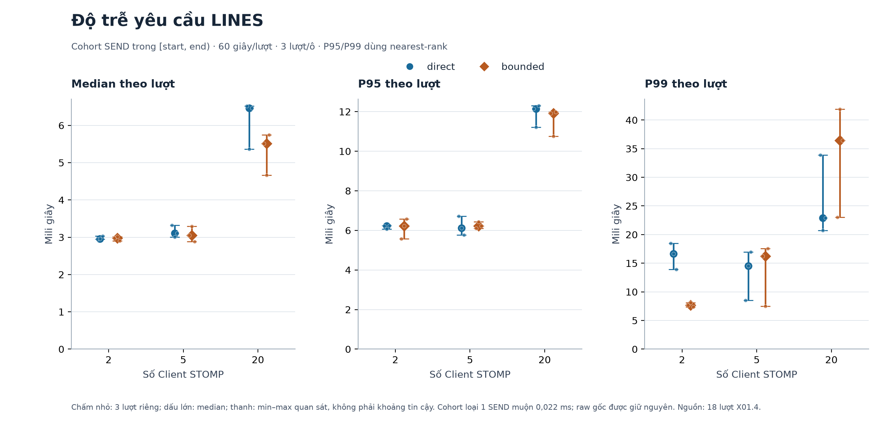
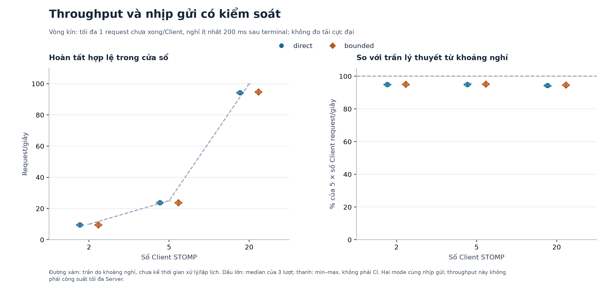
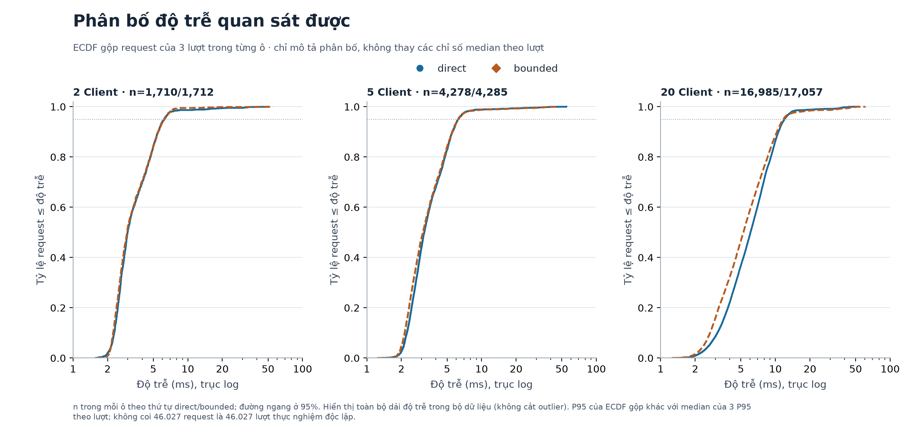
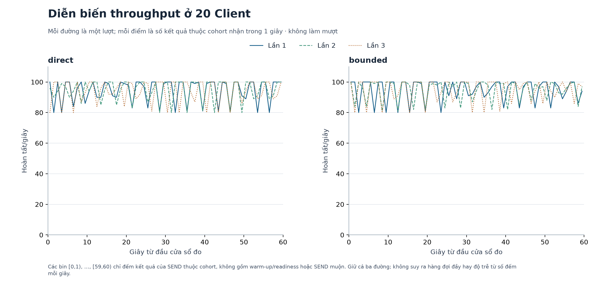
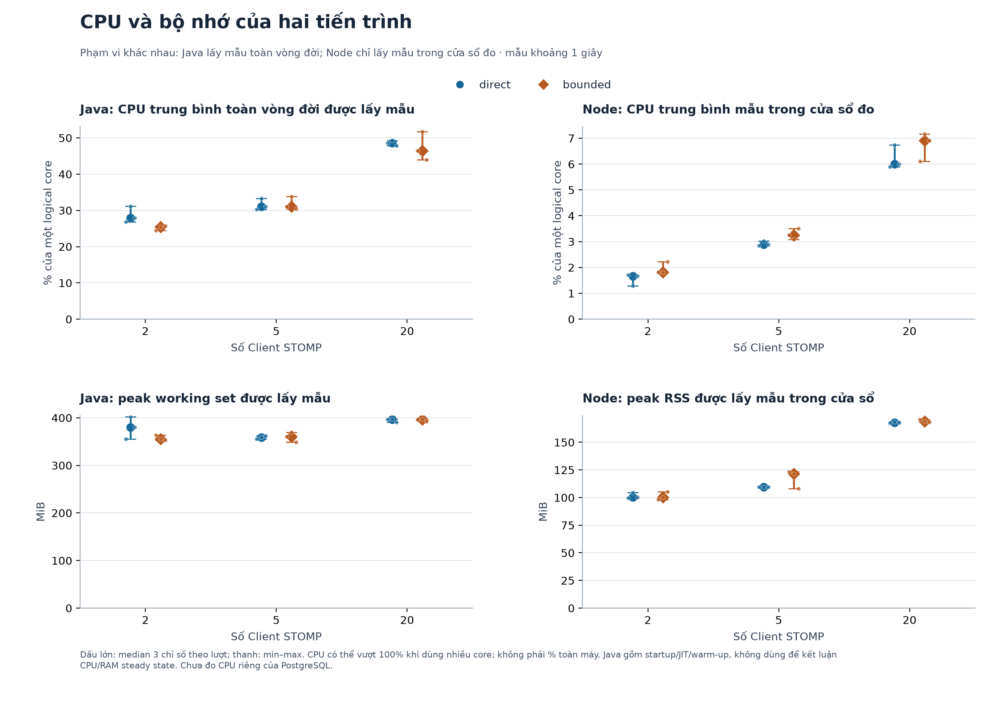

# X01.6 — Tổng hợp, biểu đồ và phân tích benchmark

**Hoàn thành phân tích ngày 29/10/2026.** Đủ 18 lượt 2/5/20 Client × direct/bounded × 3 lần; tính lại từ raw theo cohort SEND. Một SEND muộn 0,022 ms được công bố và giữ trong dữ liệu gốc. Kết quả quá tải/idempotency X01.5 được đối chiếu riêng, không nhập vào mẫu hiệu năng.

## 1. Phương pháp và chất lượng dữ liệu

Mỗi lượt đo dùng cùng JAR/JDK17/database TEST V12, warm-up 10 giây, cửa sổ 60 giây, UUID mới, một request chưa terminal/Client và nghỉ tối thiểu 200 ms. Chỉ đổi chế độ điều phối; bounded có 4 worker và queue 100. Mỗi ô có ba lần, thứ tự cân bằng theo kế hoạch 47, JVM mới cho mỗi lượt. Đây là LINES thật qua STOMP/JDBC trên loopback, không đo thao tác/render UI hoặc LAN.

Database `huyenco_benchmark_test_20261029_010531`; JAR SHA-256 `71a9d31d11adda8f50330398e87ccad6029fe7782b0a5b6239eaabf1bad0ab39`. Raw được auditor đối chiếu trước khi phân tích; hash mọi file đầu vào được kiểm lại sau khi tạo artifact. Không chạy lại benchmark để chọn số đẹp.

Cohort gồm SEND trong **[start,end)**. Latency là terminal-received trừ SEND trên cùng đồng hồ đơn điệu; median/P95/P99 chỉ tính COMPLETED hợp lệ. P95/P99 dùng nearest-rank. Throughput là số kết quả thuộc cohort nhận trước end chia 60 giây. Offered/sent rate là SEND thuộc cohort chia 60; trong bộ số liệu này hai rate bằng nhau vì tất cả kết quả cohort về trong cửa sổ.

**Bảng tổng hợp dùng median của ba chỉ số theo lượt.** Dấu ngoặc vuông là min–max của ba lượt, không phải khoảng tin cậy. Không lấy trung bình ba P95; không trộn replay/từ chối nhanh vào latency tính mới. Mỗi điểm nhỏ trên hình là một lượt; các điểm có cùng giá trị có thể chồng nhau.

Đối soát: **46.027 SEND cohort = 46.027 COMPLETED; 0 lỗi, 0 kết quả cohort thu nốt**. Toàn raw gồm 162 readiness + 7.640 warm-up + 46.027 cohort + 1 SEND ngoài ranh = 53.830 COMPLETED/215.320 progress.

Lượt 20 Client/bounded/lần 1 có 5.684 dòng gắn nhãn measurement nhưng 5.683 SEND đúng cửa sổ. Dòng muộn giữ nguyên và loại nhất quán theo timestamp, không dựa vào độ trễ/kết quả. Audit vẫn là `COHORT_AUDIT_PASS_WITH_WINDOW_DEVIATION`, `strictSendWindowSatisfied=false`. Nếu yêu cầu strict-window tuyệt đối cho bản chạy gốc, cần một ma trận mới với runner đã sửa; phân tích này không biến sai lệch đó thành PASS tuyệt đối.

## 2. Độ trễ và throughput

| Client | Mode | Tổng cohort | Median latency (ms) | P95 (ms) | Throughput (request/s) |
| --- | --- | ---: | ---: | ---: | ---: |
| 2 | direct | 1.710 | 2,96 [2,95–3,04] | 6,22 [6,06–6,24] | 9,50 [9,50–9,50] |
| 2 | bounded | 1.712 | 2,97 [2,90–3,02] | 6,23 [5,57–6,58] | 9,52 [9,50–9,52] |
| 5 | direct | 4.278 | 3,11 [3,01–3,32] | 6,12 [5,77–6,71] | 23,75 [23,75–23,80] |
| 5 | bounded | 4.285 | 3,05 [2,88–3,30] | 6,22 [6,10–6,44] | 23,82 [23,77–23,83] |
| 20 | direct | 16.985 | 6,47 [5,36–6,52] | 12,15 [11,20–12,30] | 94,35 [94,07–94,67] |
| 20 | bounded | 17.057 | 5,51 [4,66–5,75] | 11,91 [10,75–11,99] | 94,72 [94,70–94,87] |





So sánh dưới đây chỉ là phần trăm thay đổi của median theo ô: `(bounded/direct − 1) × 100`. Với latency/P95, số âm là giảm; với throughput, số dương là tăng. Không gọi đây là ước lượng hiệu ứng có ý nghĩa thống kê.

| Client | Thay đổi median latency | Thay đổi P95 | Thay đổi throughput |
| --- | ---: | ---: | ---: |
| 2 | 0,35% | 0,25% | 0,18% |
| 5 | -2,01% | 1,64% | 0,28% |
| 20 | -14,71% | -1,96% | 0,39% |

Ở 2 và 5 Client, các khoảng đo chồng lấn và thay đổi nhỏ, không đồng nhất giữa median và P95. Ở 20 Client, bounded có median latency thấp hơn khoảng 14,71%, P95 thấp hơn khoảng 1,96% và throughput cao hơn khoảng 0,39% trong mẫu đã đo. Các khoảng của hai mode vẫn chồng lấn; ba lần đo chưa đủ để kết luận bounded luôn nhanh hơn hoặc khác biệt có ý nghĩa thống kê.

Khoảng nghỉ 200 ms tạo trần lý thuyết 5 request/s/Client, tức 10/25/100 request/s trước khi tính thời gian xử lý/lập lịch. Throughput khoảng 94–95 request/s ở 20 Client phản ánh workload vòng kín này, **không phải công suất cực đại**. Không ngoại suy tuyến tính sang 100/1.000 Client hoặc dùng số này làm cam kết chịu tải.

## 3. Phân bố và diễn biến trong cửa sổ





ECDF gộp request của ba lượt chỉ dùng mô tả phân bố trong từng ô; nó không thay bảng median/P95 theo lượt và không biến các request có phụ thuộc theo phiên/thời gian thành các lượt độc lập. Trục X là log và hiển thị toàn bộ dải độ trễ quan sát, không cắt outlier. Biểu đồ theo giây giữ ba đường của 20 Client và không làm mượt; tổng 60 bin được kiểm lại bằng số hoàn tất trong cửa sổ.

| Client | Mode | Median P99 theo lượt, min–max (ms) | Max latency lớn nhất (ms) | P95 xác thực response tại runner, median (ms) |
| --- | --- | ---: | ---: | ---: |
| 2 | direct | 16,66 [13,93–18,45] | 50,14 | 0,059 |
| 2 | bounded | 7,68 [7,40–8,11] | 55,24 | 0,061 |
| 5 | direct | 14,56 [8,55–16,95] | 54,83 | 0,054 |
| 5 | bounded | 16,21 [7,49–17,59] | 46,13 | 0,050 |
| 20 | direct | 22,90 [20,74–33,91] | 52,75 | 0,039 |
| 20 | bounded | 36,41 [23,04–41,92] | 60,75 | 0,041 |

**Phần đuôi không cải thiện đồng đều:** ở 20 Client, median P99 theo lượt của bounded là 36,41 ms so với 22,90 ms của direct, cao hơn khoảng 59,00%; max quan sát cũng cao hơn (60,75 so với 52,75 ms). Vì vậy median/P95 thấp hơn không có nghĩa toàn bộ phân bố độ trễ tốt hơn. Các khoảng P99 chồng lấn và chỉ có ba lượt; dữ liệu chưa xác định được nguyên nhân là điều phối, GC, lập lịch hay yếu tố khác trên cùng máy.

Mỗi lượt đo phủ **192 cặp inputCase** theo seed benchmark, không phải toàn bộ 384 tổ hợp sáu hào/hào động. Đây là giới hạn của chu kỳ seed; kiểm đầy đủ chức năng 384 tổ hợp thuộc bộ nghiệm thu nghiệp vụ riêng. Thời gian xác thực response được ghi riêng; latency đánh dấu tại lúc callback nhận terminal, trước khi chạy oracle. Chi phí callback/validation vẫn có thể tác động lịch gửi tiếp theo.

## 4. CPU, bộ nhớ và thread



CPU tính bằng `100 × ΔCPU_time / Δelapsed`, dùng đơn vị thời gian thống nhất và trọng số theo khoảng lấy mẫu; đơn vị là **% của một logical core**, có thể vượt 100%. Không chia nhầm cho toàn máy hoặc lấy trung bình không trọng số các khoảng khác nhau. Các peak là peak được lấy mẫu khoảng một giây, không bảo đảm bắt được đỉnh ngắn hơn.

Node chỉ dùng các mốc sample nằm trong cửa sổ 60 giây; khoảng mẫu đầu–cuối thực tế là **58,23–58,37 giây**, không nội suy cho đủ 60 giây. Java dùng toàn vòng đời được lấy mẫu, **gồm startup/JIT/warm-up**, vì artifact không có mốc đồng hồ đơn điệu chung đủ chính xác để tách riêng cửa sổ Java 60 giây. Không ghép CPU hai phạm vi thành tổng, không coi working set là heap used hoặc heap limit. CPU PostgreSQL chưa được lấy mẫu riêng.

Các ô dưới đây là median [min–max] của ba chỉ số theo lượt. Peak OS thread là thread toàn tiến trình Java trên Windows, không phải số worker hay Java managed thread qua JMX.

| Client | Mode | Java CPU vòng đời (% 1 core) | Java peak working set (MiB) | Java peak OS thread | Node CPU cửa sổ (% 1 core) | Node peak RSS cửa sổ (MiB) |
| --- | --- | ---: | ---: | ---: | ---: | ---: |
| 2 | direct | 27,97 [26,84–31,12] | 380,04 [355,43–402,27] | 129 [129–131] | 1,66 [1,28–1,71] | 100,44 [99,49–104,48] |
| 2 | bounded | 25,39 [24,44–25,82] | 355,47 [352,78–363,45] | 134 [133–134] | 1,82 [1,82–2,23] | 100,50 [98,23–105,42] |
| 5 | direct | 31,09 [30,32–33,26] | 359,16 [355,64–362,31] | 130 [130–133] | 2,90 [2,84–3,03] | 109,57 [109,40–109,63] |
| 5 | bounded | 31,07 [30,39–33,83] | 360,82 [349,30–369,09] | 134 [134–135] | 3,24 [3,08–3,51] | 121,67 [108,06–123,43] |
| 20 | direct | 48,57 [47,81–49,21] | 396,43 [390,47–397,34] | 145 [145–145] | 6,00 [5,90–6,74] | 167,81 [167,59–168,50] |
| 20 | bounded | 46,45 [44,00–51,77] | 396,64 [392,59–397,64] | 149 [147–149] | 6,92 [6,11–7,16] | 168,88 [168,20–170,65] |

Không thấy CPU runner bão hòa trong mẫu: khoảng CPU Node cao nhất là 21,81% của một core; Java peak working set lớn nhất 402,27 MiB. Tuy vậy CPU trung bình thấp không chứng minh event loop/lập lịch không ảnh hưởng latency. `monitorEventLoopDelay` có resolution 20 ms và phạm vi toàn lượt gồm connect/warm-up; P95 ghi nhận khoảng 35,00–35,19 ms, không dùng làm độ trễ event loop riêng của cửa sổ hoặc so trực tiếp với request latency vài ms. Chi tiết có trong CSV từng lượt.

Bounded giới hạn bốn phép tính trong dispatcher, không giới hạn tổng thread ứng dụng thành bốn: Spring/WebSocket/JDBC/deadline/JVM còn có thread riêng. CPU/RAM vòng đời của hai mode chịu startup/JIT, GC, cache hệ điều hành và tác vụ khác trên cùng máy; bộ số liệu chưa cho phép kết luận mức tiết kiệm tài nguyên steady state của bounded.

## 5. Độ tin cậy và đối soát database

Trong ma trận hiệu năng không có SERVER_BUSY/timeout/lỗi DB/lỗi nguồn/transport/protocol hoặc sai phiên/kết quả. Điều này chỉ áp dụng mức tải đã đo: tối đa 20 việc chưa terminal so với queue 100, chưa chứng minh queue đầy.

X01.5 kiểm riêng 7/7 ca qua STOMP/PostgreSQL thật: in-flight dedupe, replay không progress, xung đột payload không đổi kết quả gốc, 20 phiên cùng ID/input khác, TTL mặc định 60 giây, reconnect và quá tải/phục hồi. Với cấu hình stress 2 worker/queue 4, burst tự nhiên 160 yêu cầu có 10 COMPLETED/150 SERVER_BUSY; ca khóa database ngắn có kiểm soát có 6 COMPLETED/154 SERVER_BUSY và hai JDBC waiter được quan sát. ID bị từ chối được gửi lại thành công. Đó là fault injection riêng, không đưa thời gian từ chối/replay/giữ khóa vào bảng hiệu năng.

18 cặp snapshot trước/sau đo đều khớp baseline. Kiểm chỉ đọc sau đo cho X01.6 tại **2026-10-29T11:21:28.437678+07:00** tiếp tục khớp toàn bộ 16 bảng tri thức/migration và schema; hai bảng phiên/lịch sử giữ 0 dòng. Knowledge hash `115d9ced12f174341833dbe88ed5a15850a40f63e05a3922244bb6c2d77a01cc`, schema hash `16bc7fcec71e6af200a9f2f80a33da0ac87dd48888b586500dd0361b8b25752a`. Không import/migrate hoặc thay dữ liệu để phân tích.

## 6. Giới hạn và ý nghĩa kỹ thuật

Kết quả hỗ trợ việc giữ bounded làm cấu hình mặc định để điều phối có giới hạn, kết hợp bằng chứng từ chối có kiểm soát/phục hồi ở X01.5. Kết quả không yêu cầu bounded phải thắng direct ở mọi chỉ số. Cả hai mode cùng có idempotency, vì vậy chênh lệch hai mode không đo lợi ích riêng của cache/dedupe.

Ba lượt/ô, cùng máy loopback, cùng dataset và tải có khoảng nghỉ là phạm vi thực nghiệm. Mỗi lượt có JVM mới nhưng PostgreSQL/OS cache không bị xóa; thứ tự cân bằng giảm thiên lệch thứ tự, không loại hết yếu tố gây nhiễu. Không suy rộng sang TIME/Tam Thế/lời luận chi tiết/REST/history, nhiều máy, mạng chậm, phần cứng khác, độ bền qua crash hoặc tải mở không có khoảng nghỉ. Không báo p-value/CI hoặc khẳng định tương đương thống kê từ các khoảng min–max.

Sai lệch SEND muộn 0,022 ms vẫn là giới hạn kiểm soát của ma trận gốc. Sửa runner và smoke sau sửa có bằng chứng riêng, không thay lượt chính thức hoặc xóa dòng ngoài ranh. Nếu giảng viên yêu cầu ma trận strict-window tuyệt đối thì cần đo mới, không chỉ sửa báo cáo.

## 7. Artifact và tái lập

- [Chỉ số đủ 18 lượt](tables/per-run.csv): median/P95/P99/mean/max, offered/throughput, sample count, ranh thời gian và tài nguyên/phạm vi.
- [Tổng hợp sáu ô](tables/aggregate.csv): ba giá trị gốc theo thứ tự lần 1/2/3, median/min/max.
- [Chênh lệch mô tả bounded/direct](tables/differences.csv); [số hoàn tất theo giây](tables/timeline.csv); [SEND ngoài ranh](tables/boundary-exclusions.csv).
- [Manifest bản bàn giao](tables/publication-manifest.json): hash artifact, nguồn dữ liệu và phiên bản công cụ; PNG để chèn báo cáo, SVG cùng tên để xuất nét.

Công cụ `scripts/summarize_x01_benchmark.py` đọc raw và gọi lại auditor, tạo một thư mục `scripts/generated/x01_analysis_<timestamp>/` mới, lưu JSON/CSV/PNG/SVG cùng hash đầu vào/đầu ra và snapshot mã phân tích. Thư mục raw X01.4/X01.5 được giữ nguyên. Chạy lại offline bằng Python có Matplotlib/NumPy:

```powershell
python .\scripts\summarize_x01_benchmark.py
```

Thêm `--publish` để cập nhật các bảng/ảnh trong `docs/assets/x01/` và tài liệu này, sau đó kiểm trực quan trước khi dùng bản mới. Không khởi động Server, không tự đo thêm và không ghi PostgreSQL. Kiểm database trực tiếp là bước chỉ đọc riêng; công cụ dùng file kiểm đã ghi nhận trong manifest, không yêu cầu lưu mật khẩu trong repo. Các manifest/JAR/raw gốc trong `scripts/generated/` được Git ignore, nên clone code và ảnh chưa đủ đầu vào để tái lập; cần bộ artifact gốc tương ứng. Phiên bản Python/Matplotlib/NumPy đã dùng nằm trong manifest bàn giao.

**X01.6 đã hoàn thành tổng hợp/biểu đồ/phân tích trong phạm vi dữ liệu hiện có. Tiếp theo X01.7 — đưa Experimental Setup, Results, Discussion và liên kết bằng chứng vào báo cáo nộp; chưa đóng toàn task X01 hoặc tiêu chí strict-window của X01.4.**
