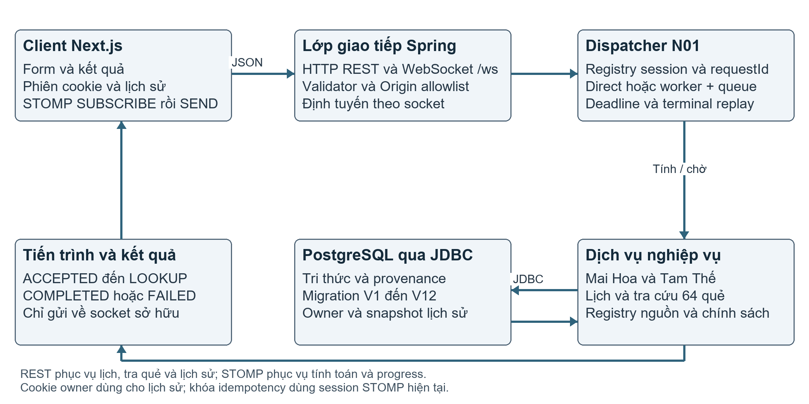
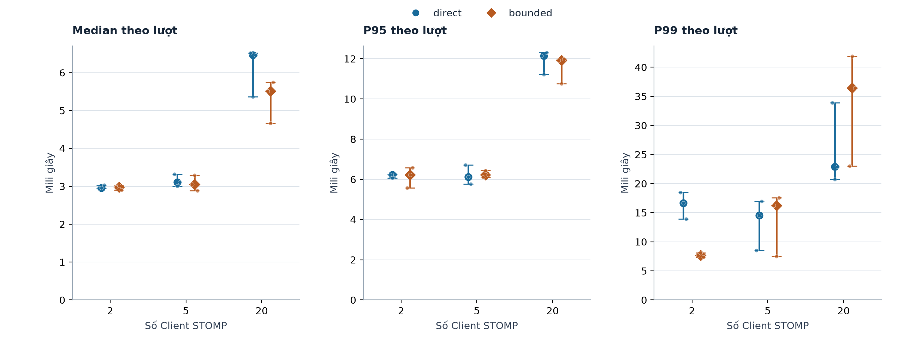
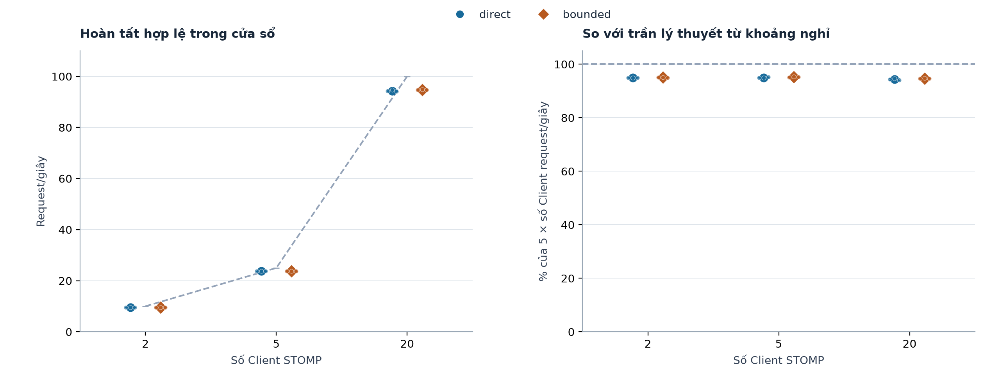
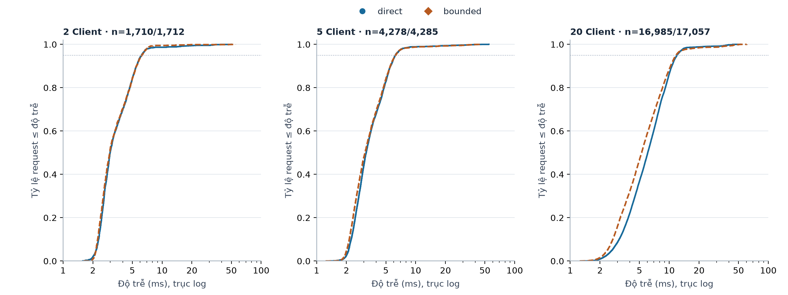
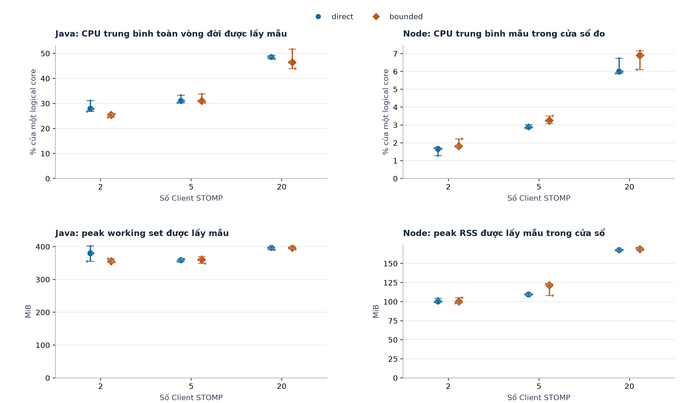
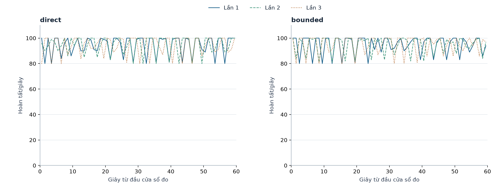

# HUYỀN CƠ

Ứng dụng tra cứu tri thức qua mạng
với điều phối hữu hạn và truy vết nguồn

Nhóm 12 · Đào Viết Trọng — B23DCCN846
Doãn Duy Linh — B23DCCN482
Bùi Ngọc Mạnh — B23DCCN526

Bài tập lớn Lập trình mạng · Năm học 2026–2027 · Cập nhật ngày 01 tháng 11 năm 2026

### Tóm tắt

Huyền Cơ là ứng dụng Client–Server tra cứu tri thức Mai Hoa Dịch Số và Diễn Cầm Tam Thế. Bài toán kỹ thuật là tiếp nhận nhiều yêu cầu tính toán qua mạng, trả tiến trình đúng phiên, kiểm soát công việc trùng và quá tải, đồng thời bảo toàn căn cứ của dữ liệu số hóa. Hệ thống sử dụng Next.js, Spring Boot, STOMP trên WebSocket và PostgreSQL; Server chịu trách nhiệm tính toán và kiểm chính sách nguồn. Đóng góp triển khai gồm dispatcher với worker/hàng đợi hữu hạn, registry idempotency theo phiên và kết quả có provenance. Thực nghiệm trên cùng máy sử dụng 2/5/20 Client, hai chế độ direct/bounded và ba lần lặp, tạo 18 lượt đo. Cohort theo timestamp có 46.027 yêu cầu thành công, không lỗi ở mức tải đã chọn. Với 20 Client, median độ trễ của bounded là 5,51 ms so với 6,47 ms của direct, nhưng median P99 cao hơn, 36,41 ms so với 22,90 ms. Kiểm độ tin cậy riêng đạt bảy tình huống; stress 2 worker/queue 4 thể hiện từ chối có kiểm soát và phục hồi. Một SEND muộn 0,022 ms được công bố; số đo không được diễn giải thành công suất cực đại hay ưu thế trên mọi mức tải. [5–7]

Từ khóa: Client–Server; WebSocket; STOMP; hàng đợi hữu hạn; idempotency; truy vết nguồn.

## 1. Giới thiệu (Introduction)

### 1.1. Bối cảnh và động lực xây dựng Huyền Cơ

Một ứng dụng tra cứu tri thức có thể trả kết quả đúng ở một phiên nhưng vẫn thất bại khi nhiều Client gửi đồng thời, gửi lặp hoặc rời kết nối. Vì vậy mục tiêu của Huyền Cơ gồm cả nghiệp vụ lẫn thiết kế giao tiếp: request phải được kiểm tra, tiến trình được tương quan bằng requestId, kết quả trả đúng socket và giới hạn tài nguyên có hành vi rõ ràng. Nguồn sách còn có chỗ mờ hoặc khác cách áp dụng, nên hệ thống phải phân biệt nội dung đã đối chiếu với quy ước nhóm. [8–10]

### 1.2. Mục tiêu và phạm vi hệ thống

Hệ thống tách Client Next.js, Server Spring Boot và PostgreSQL. Server tính Mai Hoa theo LINES, OBJECT_COUNT, TIME; tra cứu Tam Thế, 64 quẻ, lịch Âm–Dương/Can Chi; Client hiển thị tiến trình và kết quả, người dùng có thể lưu/xem/xóa lịch sử theo phiên sở hữu. Báo cáo chỉ đánh giá những nhánh đã có mã và bằng chứng nghiệm thu; không coi nội dung luận giải là dự đoán khoa học. [9–13]

### 1.3. Các chức năng chính và yêu cầu Lập trình mạng

Báo cáo trình bày kiến trúc, protocol, thuật toán ở phạm vi đã triển khai và bằng chứng thực nghiệm. Trọng tâm đánh giá là lát cắt LINES trên dữ liệu TEST cố định; các chức năng TIME, OBJECT_COUNT, Tam Thế, lịch và lịch sử được mô tả theo module và biên bản nghiệm thu tương ứng. Nội dung văn hóa truyền thống được trình bày có nguồn và giới hạn, không coi là dự đoán khoa học.

Yêu cầu mạng là tương quan requestId với đúng phiên STOMP, trả progress và một terminal, giới hạn yêu cầu đang chạy, xử lý gửi lặp, mất kết nối và từ chối quá tải có mã. REST phục vụ tra cứu, lịch, phiên và lịch sử; STOMP phục vụ phép tính có tiến trình. [8,9,11]

### 1.4. Tiêu chí đánh giá chức năng, hiệu năng và độ tin cậy

Chức năng được đánh giá bằng ca Client–Server–PostgreSQL TEST đại diện: ba phương pháp Mai Hoa, Tam Thế, tra cứu quẻ, lịch, lưu/xem/xóa lịch sử và quyền sở hữu. Một ca chỉ đạt khi input, requestId, tiến trình, kết quả, trạng thái nguồn và mã lỗi phù hợp hợp đồng; các ca đại diện không chứng minh toàn bộ miền input. [9,13]

Hiệu năng được mô tả bằng latency median/P95/P99, throughput và số lỗi của ma trận 2/5/20 Client × direct/bounded × ba lần, cùng phương pháp cohort đã chốt trước khi tổng hợp. Nhóm không đặt SLA hay ngưỡng thắng tuyệt đối trước phép đo, nên không đổi số đo thành nhãn đạt/chưa đạt tùy kết quả. [5,7]

Độ tin cậy được kiểm riêng bằng bảy tình huống quá tải/idempotency, định tuyến phiên, replay, reconnect và TTL. Trạng thái dữ liệu phải có căn cứ theo từng bản ghi; SOURCE_VERIFIED không được suy từ một mục đã duyệt sang toàn bộ sách. [6,10,12]

### 1.5. Cấu trúc báo cáo

Mục 2–4 trình bày cơ sở, bài toán và giải pháp; mục 5–7 mô tả kiến trúc, giao tiếp mạng và triển khai. Mục 8 nêu thiết lập đo, mục 9 công bố kết quả, mục 10 thảo luận. Mục 11–14 nêu đóng góp, giới hạn, hướng phát triển và kết luận; phụ lục A–F giữ hợp đồng, cách chạy, fixture và bằng chứng chi tiết.

## 2. Background / Related Work

### 2.1. Client–Server, HTTP/REST, STOMP WebSocket và PostgreSQL

WebSocket cung cấp kênh giao tiếp hai chiều sau opening handshake trên TCP. STOMP bổ sung frame với lệnh, header và body; Client sử dụng SEND và SUBSCRIBE để gửi yêu cầu, nhận thông điệp theo destination. Trong Spring, handler ứng dụng và broker nội bộ đảm nhiệm các phần định tuyến khác nhau. Các chuẩn này cung cấp cơ chế vận chuyển; hợp đồng nghiệp vụ và nghĩa của các queue vẫn do ứng dụng định nghĩa. [1–3]

Ở lớp thực thi, ThreadPoolExecutor cho phép đặt số luồng, hàng đợi và chính sách khi không nhận thêm công việc. Nhóm dùng fixed-size pool, ArrayBlockingQueue và AbortPolicy. Đây là áp dụng cơ chế thư viện để giới hạn việc tính toán, không phải thuật toán thread pool mới. Baseline direct thực hiện phép tính trên luồng gọi dispatcher của Spring; direct vẫn có thể phục vụ nhiều Client đồng thời. [4,8]

HTTP/REST phù hợp truy vấn và thao tác tài nguyên; STOMP/WebSocket giữ một kết nối để Server đẩy tiến trình, kết quả và lỗi theo phiên. PostgreSQL giữ dữ liệu sách, trạng thái duyệt và lịch sử; khác nhau ở vai trò, các công nghệ này không phải các phương án benchmark thay thế cho nhau. [1–3,9,11]

### 2.2. Các hệ thống và giải pháp liên quan

Báo cáo xét ba giải pháp kỹ thuật có thể kiểm chứng: WebSocket/STOMP theo đặc tả và Spring; ThreadPoolExecutor với hàng đợi hữu hạn; và baseline direct trong chính Huyền Cơ. Chưa có phép so sánh chức năng hoặc thực nghiệm với một sản phẩm Dịch học bên ngoài, vì vậy không gán các kết quả nội bộ cho hệ thống khác. [1–4,8]

Bảng 1. Đối chiếu các giải pháp liên quan

| Giải pháp | Vai trò | Khoảng trống được Huyền Cơ xử lý |
| --- | --- | --- |
| WebSocket/STOMP + Spring | Vận chuyển và định tuyến frame | Hợp đồng requestId, progress/terminal và quyền theo phiên do ứng dụng định nghĩa |
| ThreadPoolExecutor | Worker, queue và từ chối khi đầy | Admission, deadline, cleanup và ánh xạ SERVER_BUSY vào STOMP |
| Baseline direct nội bộ | Tính trên luồng gọi dispatcher | Đối chứng cùng service, dữ liệu và idempotency với bounded |

### 2.3. Nhận xét và vị trí của Huyền Cơ so với các giải pháp liên quan

Hai mode chia sẻ thuật toán, cơ chế xác thực input, registry idempotency và dữ liệu nguồn. So sánh này chỉ thay điều phối; không so một baseline trả lỗi hoặc tính khác nghiệp vụ với một bản trả kết quả đầy đủ. Báo cáo không có thí nghiệm đối đầu với sản phẩm thương mại hoặc khảo sát đầy đủ công trình học thuật tương tự, nên không khẳng định tính mới ở cấp độ nghiên cứu thế giới.

Đóng góp nằm ở cách tích hợp các cơ chế đã biết cho yêu cầu có nguồn, đúng phiên và kiểm soát quá tải, cộng với phép so sánh direct/bounded có cùng workload. Không tuyên bố sáng tạo một protocol hoặc thuật toán hàng đợi mới. [5–8]

## 3. Problem Definition

Bài toán là xử lý yêu cầu tính/tra cứu tri thức từ nhiều Client sao cho kết quả đúng nghiệp vụ, không lẫn phiên, không thực hiện trùng không cần thiết và không nhận vô hạn khi tài nguyên đã kín. Dữ liệu sách có phạm vi xác minh khác nhau; Server chỉ sử dụng quy tắc/nội dung được phép và trả trạng thái nguồn đúng hồ sơ. [8–12]

Bảng 2. Đầu vào và đầu ra theo nhóm chức năng

| Nhóm | Đầu vào | Đầu ra |
| --- | --- | --- |
| Mai Hoa | LINES hoặc số vật/giờ Chi hoặc thời điểm | Quẻ chủ/hỗ/biến, hào động, bước tính; lời luận khi chọn reading |
| Tam Thế | Ngày/giờ sinh, loại lịch, tháng nhuận, category | Các mục luận có nguồn; trạng thái không khớp nguồn được giữ rõ |
| Tra cứu và lịch | Tên/mã quẻ; ngày và loại lịch | Thông tin quẻ hoặc lịch chuyển đổi/Can Chi |
| Lịch sử | Phiên owner; requestId kết quả đã tính | Snapshot kết quả, tìm/xem/xóa đúng owner |

Đầu vào được kiểm trên Server; Client không được cấp quyền duyệt nguồn hoặc tự gửi snapshot để lưu. Miền lịch dự án là 1900–2099 với UTC+7 cố định. Các yêu cầu tính toán mang UUID; kết nối STOMP được giữ riêng với cookie owner dùng cho lịch sử. Khi không đủ dữ liệu hoặc điều kiện chính sách, Server trả lỗi có mã thay vì tạo nội dung bù. [9–12]

Đầu ra thành công có requestId, type, trạng thái COMPLETED, dữ liệu và căn cứ; đầu ra thất bại có FAILED cùng mã lỗi. Với lịch sử, Client chỉ gửi requestId của kết quả đã tính, còn Server lưu snapshot thuộc owner. Hiệu năng được đo trên một lát cắt LINES cố định, không đại diện tự động cho tất cả chức năng. [5,9,11]

## 4. Proposed Approach

### 4.1. Ý tưởng tổng thể

Yêu cầu qua STOMP được parse JSON/UTF-8 nghiêm ngặt, sau đó dispatcher kiểm registry theo cặp sessionId/requestId. ID mới được nhận vào vòng đời Run với deadline; ID trùng có cùng fingerprint chia sẻ công việc đang chạy hoặc replay terminal còn hiệu lực. Nội dung khác cùng ID bị từ chối. Trong bounded, chỉ worker thực thi nghiệp vụ; queue đầy trả SERVER_BUSY, không chuyển việc sang luồng nhận STOMP để né giới hạn. [8]

### 4.2. Các quyết định thiết kế

Service tra registry nguồn trước khi tính hoặc lấy lời luận. Dữ liệu kết quả giữ ruleVersion, ruleBasis, sourceStatus, sourceReferences và decisionReferences. Chính sách SOURCE_VERIFIED và TEAM_DECISION được phân biệt với trạng thái nguồn. TIME dùng quy ước chia 6 đã chốt cho dự án; OBJECT_COUNT giữ TEAM_DECISION/SOURCE_AMBIGUOUS theo hồ sơ. Một quyết định nhóm không biến bản in chưa rõ thành chứng cứ ấn bản đã được xác minh. [9–10]

Các quyết định nhóm được ghi tách khỏi văn bản sách: phép chia 6 lấy dư xác định hào động; dư 0 ứng với hào 6; OBJECT_COUNT nhận objectCount và hourIndex, không dùng mảng numbers hai phần tử. Chỗ nguồn mờ hoặc chưa xác minh ấn bản được công bố đúng trạng thái, không đổi thành SOURCE_VERIFIED chỉ vì nhóm đã chốt cách thực thi. [9,10]

### 4.3. Thuật toán Mai Hoa, Tam Thế, lịch Âm–Dương và Can Chi; căn cứ sách và quyết định nhóm

Mai Hoa LINES dựng quẻ từ sáu hào, quẻ hỗ từ hào 2–4 và 3–5, quẻ biến bằng đảo một hào động. OBJECT_COUNT lấy objectCount mod 8, hourIndex mod 8 và (objectCount + hourIndex) mod 6 với dư 0 quy về 8 hoặc 6 tương ứng; TIME dùng lịch/giờ Việt Nam UTC+7 và quy ước nhóm đã công bố. Tam Thế dùng khóa Can Chi năm âm, tháng sinh và mục luận. Chi tiết triển khai và giới hạn nằm ở 7.3–7.4. [9,10,12]

### 4.4. Data flow và communication flow

Client kiểm biểu mẫu → REST tạo phiên khi cần lịch sử → STOMP kết nối và SUBSCRIBE → SEND requestId/payload → Server kiểm hợp đồng và nguồn → dispatcher nhận hoặc từ chối → service/JDBC tính/tra cứu → progress và terminal về đúng socket. Lưu lịch sử là thao tác REST riêng sau terminal; sơ đồ thành phần ở mục 5 và trình tự frame ở mục 6. [8,9,11]

## 5. System Architecture



Client quản lý nhập liệu và hiển thị; Server giữ thuật toán và quyền truy cập. REST phục vụ các thao tác tra cứu/lịch/lịch sử; WebSocket duy trì kênh progress và kết quả tính toán. PostgreSQL chứa tri thức có nguồn, metadata review và snapshot lịch sử. H01 lưu định danh owner bằng hash token, tách khỏi session STOMP dùng cho định tuyến và N01. [11]

Đây là kiến trúc logic của bản chạy thử: Client có thể ở máy khác, còn Backend kết nối PostgreSQL qua JDBC. Phép đo X01 đặt runner, Backend và PostgreSQL trên cùng máy qua loopback; sơ đồ không hàm ý benchmark đã đo mạng LAN hoặc triển khai Internet. [5]

## 6. Network Communication Design

### 6.1. HTTP/REST, STOMP qua WebSocket /ws và cổng cấu hình của Client, Backend, PostgreSQL

Client gọi các route /api/v1 qua proxy Next.js tới Backend. Các phép tính có tiến trình dùng STOMP trên /ws. Trong ma trận X01, Backend HTTP/WS dùng 127.0.0.1:18091, Client origin 127.0.0.1:3173; đó là cấu hình đo, không phải cổng cố định của sản phẩm. PostgreSQL chỉ cần Backend truy cập và không phải mở cho Client. [5,9,11]

### 6.2. Hợp đồng JSON: requestId, type, payload, progress, kết quả và mã lỗi

```json
{
  "requestId": "550e8400-e29b-41d4-a716-446655440002",
  "type": "MAI_HOA",
  "payload": {
    "method": "LINES",
    "linesBottomUp": [true, false, true, false, true, false],
    "movingLine": 2
  }
}
```

Progress mang requestId, type, sequence, step và message; chuỗi thành công gồm ACCEPTED, VALIDATING, CALCULATING, LOOKUP. Terminal mang requestId/type/status/data/error; thành công COMPLETED có error=null, thất bại FAILED có mã lỗi. Các frame được trả về socket tương ứng; Client không được SEND trực tiếp vào broker queue hoặc SUBSCRIBE queue của phiên khác. Hợp đồng JSON v1.2 khác với phiên bản STOMP 1.2 dù cùng con số. [2,9]

### 6.3. Trình tự khởi tạo phiên → kết nối STOMP → gửi yêu cầu → nhận tiến trình và kết quả

Client mở WebSocket /ws, hoàn tất STOMP CONNECT/CONNECTED rồi subscribe /user/queue/progress, /user/queue/results và /user/queue/errors trước SEND. Tuyến tính toán là /app/mai-hoa/calculate hoặc /app/tam-the/calculate. Với lịch sử, Client bootstrap cookie owner qua POST /api/v1/session trước handshake; cookie hợp lệ được gắn owner phía Server. Client công khai không cookie vẫn tính được nhưng không có snapshot owned để lưu. [9,11]

### 6.4. Thiết kế kênh REST và STOMP WebSocket

#### 6.4.1. REST: phiên người dùng, tra cứu quẻ, chuyển đổi lịch và lịch sử

GET /api/v1/hexagrams và /api/v1/hexagrams/{code} tra quẻ; POST /api/v1/calendar/convert và /api/v1/calendar/can-chi xử lý lịch. POST /api/v1/session cấp phiên; POST/GET /api/v1/history, GET/DELETE /api/v1/history/{id} phục vụ lịch sử. GET /api/v1/health kiểm tiến trình HTTP, còn /api/v1/readiness kiểm kho tri thức/schema/seed. Hợp đồng chi tiết ở Phụ lục A và [9,11].

#### 6.4.2. STOMP: destination gửi/nhận, định tuyến theo phiên và đối chiếu requestId

Client SEND tới /app/mai-hoa/calculate hoặc /app/tam-the/calculate, sau khi SUBSCRIBE /user/queue/progress, /user/queue/results và /user/queue/errors. Client ghép frame theo requestId và type; Server chặn truy cập trực tiếp broker queue hoặc user queue của phiên khác. [9]

#### 6.4.3. Origin, cookie phiên, CSRF, giới hạn thông điệp và quyền truy cập lịch sử

Ghi/xóa lịch sử yêu cầu cookie owner, custom header và CSRF hợp lệ; truy cập history của owner khác trả 404. Origin allowlist và bảo vệ cookie/CSRF là lớp riêng với session routing. Các lượt benchmark dùng loopback HTTP/WS; chưa phải nghiệm thu TLS hoặc triển khai Internet. [11]

Cookie huyenco_session là HttpOnly, SameSite=Lax; thao tác ghi/xóa cần X-HuyenCo-Request và X-CSRF-Token. Frame/body tối đa 16.000 byte và giải mã UTF-8 nghiêm ngặt. Khi chạy hai máy phải cấu hình Origin và cookie theo hostname thật; không tắt kiểm tra để vượt lỗi kết nối. [9,11]

### 6.5. Quản lý kết nối: heartbeat, mất kết nối, kết nối lại và hết hạn phiên

Client đặt connection timeout 10 giây và reconnect delay 3 giây. Disconnect hủy Run/timer và registry của socket; reconnect tạo STOMP session mới, nên cùng requestId có thể tạo phép tính mới. H01 owner cookie có vòng đời riêng 30 ngày. Chưa có bằng chứng cấu hình nhịp heartbeat cụ thể hoặc nghiệm thu live mọi kiểu mất mạng, vì vậy mục này chỉ mô tả các timeout/reconnect đã có. [8,11,13]

### 6.6. Xử lý lỗi đầu vào, dữ liệu chưa sẵn sàng, quá tải và lỗi database

JSON hỏng, field lạ và input sai bị từ chối; xung đột requestId trả INVALID_INPUT; từ chối admission trả SERVER_BUSY. Deadline của Run gồm thời gian chờ queue; vượt hạn trả PROCESSING_TIMEOUT và chặn terminal/progress muộn. Disconnect hủy Run/timer, yêu cầu interruption và xóa registry của phiên; reconnect tạo session mới. Interruption là best effort, không bảo đảm JDBC đang kẹt dừng ngay. [8]

Các mã nghiệp vụ gồm INVALID_INPUT, RULE_NOT_AVAILABLE, SERVER_BUSY, PROCESSING_TIMEOUT, KNOWLEDGE_DATA_INCOMPLETE và DATABASE_UNAVAILABLE. Lỗi hợp đồng trả về terminal hoặc HTTP error theo kênh; không trả SQL/secret cho Client. [9]

## 7. Implementation

### 7.1. Nền tảng Java/Spring Boot, Next.js/React, PostgreSQL và cấu hình mạng

Bảng 3. Thành phần chính và trách nhiệm

| Module | Vai trò |
| --- | --- |
| CalculationController | Parse nghiêm ngặt, kiểm hợp đồng, gọi service và ánh xạ lỗi |
| CalculationDispatcher | Admission nguyên tử, worker/queue, fingerprint và replay terminal |
| CalculationSessions | Run, progress/terminal theo socket, deadline và cleanup |
| MaiHoaService / TamTheService | Thuật toán và bảng tra có điều kiện nguồn |
| RuleRegistry / JDBC repositories | Cổng chính sách, snapshot dữ liệu và truy vết nguồn |
| H01 và Client | Owner/history/CSRF; nhập liệu, nhận STOMP và hiển thị |

### 7.2. Số hóa tri thức, database và tra cứu 64 quẻ

#### 7.2.1. Cấu trúc mã nguồn và phân chia module

Repo tách client/, server/, docs/, scripts/ và report/. Backend có module websocket, maihoa, tamthe, calendar, hexagram, history và knowledge; Client giữ form, dịch vụ HTTP/STOMP và thành phần kết quả. Bảng thành phần ở 7.1 nêu ranh giới trách nhiệm. [8,9,11]

#### 7.2.2. Mô hình dữ liệu quẻ, lời luận, quy tắc và nguồn sách

PostgreSQL lưu cấu trúc 8 quái/64 quẻ, sáu hào, quy tắc tính, nghĩa tên, các mục luận và metadata sách/trang/reviewer/status. Dữ liệu kết quả mang provenance theo từng mục; 64 nghĩa tên đã duyệt trong phạm vi NAME_GLOSS không kéo theo duyệt mọi lời luận. [10,12]

#### 7.2.3. Migration Flyway, nhập dữ liệu, ràng buộc toàn vẹn và trạng thái duyệt

Schema V1–V12 phân biệt sách/mục nguồn, bát quái/quẻ/hào, quy tắc, nội dung tra và metadata review; V11 bổ sung owner/history, V12 dữ liệu mở rộng. H01 lưu snapshot Result DTO đã tính trên Server theo owner; không nhận payload/snapshot hoặc trạng thái duyệt do Client tự cung cấp. Phạm vi VERIFIED được xác định theo từng hồ sơ; tên quẻ đã duyệt không chứng minh mọi thuật toán hay mọi lời luận đã được duyệt. [10–12]

#### 7.2.4. API tra cứu 64 quẻ và hiển thị nguồn trên Client

API trả danh sách phân trang và chi tiết theo mã H_UPPER_LOWER, hỗ trợ tên có/không dấu và lọc quái; Client trình bày tên, cấu trúc và căn cứ thay vì suy nguồn từ giao diện. Không biến NAME_GLOSS đã VERIFIED thành xác nhận tất cả văn bản quẻ. [9,10,13]

### 7.3. Lập quẻ và luận giải Mai Hoa, Tam Thế

#### 7.3.1. Đầu vào, đầu ra và giới hạn của từng nghiệp vụ

LINES nhận sáu boolean từ dưới lên và movingLine 1–6; OBJECT_COUNT nhận objectCount/hourIndex; TIME nhận thời điểm có offset. Tam Thế nhận lịch sinh, tháng nhuận và chủ đề. Lời luận Mai Hoa chi tiết là lựa chọn riêng; dữ liệu Tam Thế không khớp nguồn được ghi rõ, không sinh bù. [9,10,12]

#### 7.3.2. Kiểm tra đầu vào, chọn quy tắc và điều kiện nguồn được duyệt

Server kiểm kiểu/miền giá trị và rule registry trước khi chạy. Kết quả ghi ruleVersion, ruleBasis, sourceStatus và tham chiếu; SOURCE_VERIFIED và TEAM_DECISION được phân biệt theo hồ sơ. [9,10]

#### 7.3.3. Mai Hoa LINES, OBJECT_COUNT, TIME: quẻ chủ, quẻ hỗ, quẻ biến và hào động

Với LINES, sáu hào được đánh số từ dưới lên. Hỗ hạ lấy hào 2–4, hỗ thượng lấy hào 3–5; quẻ biến đảo duy nhất hào động. OBJECT_COUNT dùng số vật lấy thượng quái, chỉ số giờ Chi lấy hạ quái; tổng số gốc chia 6 lấy hào, dư 0 quy về 6. TIME chuẩn hóa UTC+7 và lấy năm/tháng/ngày âm cùng giờ Chi theo quy ước đã công bố. Luận chi tiết là chức năng opt-in riêng với mẫu đã review, không phải output mặc định của workload benchmark. [9–10]

#### 7.3.4. Sinh lời luận Mai Hoa: Thể–Dụng, ngũ hành, giai đoạn và căn cứ nguồn

M03 đọc bộ mẫu đã review, xác định Thể/Dụng theo vị trí hào động và quan hệ ngũ hành, rồi trình bày nhận xét theo chủ đề và giai đoạn kèm căn cứ. Kết quả chi tiết có phạm vi dữ liệu; không hứa lời luận hoàn chỉnh cho mọi đầu vào ngoài bộ nguồn đã duyệt. [10]

#### 7.3.5. Tam Thế: khóa tra cứu và luận giải theo từng chủ đề được hỗ trợ

Tam Thế chuẩn hóa lịch, lấy Can Chi năm âm và hành mệnh rồi tra bảng theo loại nội dung. EXTENDED giữ Lộc, Sang hèn và Điền sản thành các mục riêng; không có giao điểm nguồn của Lộc được ghi NO_SOURCE_MATCH, không tự sinh lời thay thế. Lịch C01 dùng dataset cố định tạo và cross-check với Time4J 5.9.4; kiểm cùng thư viện không được gọi là nguồn thiên văn độc lập. [12]

#### 7.3.6. Trả tiến trình thời gian thực và hiển thị kết quả, nguồn, quyết định nhóm

Server phát bốn bước progress và terminal theo socket; Client hiển thị ba quẻ, lời luận khi có, nguồn sách và quyết định nhóm tách biệt. Một yêu cầu thất bại có mã lỗi thay vì kết quả giả. [9,13]

#### 7.3.7. Kiểm thử thuật toán, dữ liệu nguồn và hợp đồng kết quả

Kiểm thử module kiểm phép biến hào, lookup, điều kiện nguồn và DTO; fixture hợp đồng và nghiệm thu UI đại diện bổ sung bằng chứng tích hợp. Các số test ở mốc khác nhau không cộng thành một tổng chung. [9,10,13]

### 7.4. Chuyển đổi lịch Âm–Dương, tháng nhuận và tính Can Chi

C01 chuyển đổi trong miền 1900–2099 theo UTC+7, xử lý tháng nhuận và Can Chi; dataset cố định được cross-check với Time4J 5.9.4. Kiểm cùng thư viện không là xác minh thiên văn độc lập. [12]

### 7.5. Xử lý đồng thời: direct, bounded, hàng đợi hữu hạn và idempotency

N01 dùng cùng service cho direct/bounded. Bounded có 4 worker, queue 100, deadline gồm cả thời gian chờ; registry theo sessionId/requestId chia sẻ in-flight, replay terminal trong TTL 60 giây và chặn xung đột payload. Stress riêng kiểm hành vi đầy queue; số đo ở mục 9 không đo lợi ích idempotency riêng. [6,8]

### 7.6. Phiên người dùng, chủ động lưu kết quả và tra cứu/xóa lịch sử

H01 chỉ lưu khi Client gọi POST history sau kết quả; Server lấy snapshot kết quả đã tính theo calculationRequestId và owner, không nhận snapshot tự khai. GET list/detail và DELETE kiểm quyền owner; ghi/xóa cần cookie, custom header và CSRF. [11,13]

### 7.7. Kiểm thử đơn vị, hợp đồng, tích hợp và nghiệm thu Client–Server–PostgreSQL

Các biên bản Client 8E/8F ghi nhận nghiệm thu UI/HTTP/STOMP ở những ca đại diện và hai owner. Chúng được giữ riêng với kết quả Backend và X01; không suy từ vài ca UI thành kiểm hết miền input hoặc mọi tình huống lỗi mạng. [13]

Bằng chứng chức năng 8E/8F thuộc ca live đại diện, còn X01 là workload LINES riêng trên TEST. Chúng xác nhận các phạm vi khác nhau và được công bố tách ở mục 9.1–9.5. [5,13]

## 8. Experimental Setup

### 8.1. Máy chạy thử, phiên bản Backend, cấu hình JVM, PostgreSQL TEST và mô hình kết nối

Bảng 4. Môi trường đã ghi nhận của ma trận

| Thành phần | Giá trị |
| --- | --- |
| CPU | Intel Core i7-13620H; 10 core, 16 logical processor |
| RAM hệ thống | 25.458.917.376 byte theo snapshot môi trường |
| Hệ điều hành | Windows 11 Home Single Language 64-bit, 10.0.26300 |
| Backend | JDK 17.0.12; Spring Boot 3.5.16; heap 256–512 MiB |
| Runner | Node.js 24.21.0; @stomp/stompjs 7.5.0; ws 8.22.0 |
| Database | PostgreSQL 18.6, database benchmark TEST riêng, schema V12 |
| Mạng | Cùng máy, loopback 127.0.0.1; HTTP 18091, WS /ws |
| Origin / kết nối | http://127.0.0.1:3173; 20/5/2 socket thật tùy lượt |

Bảng 5. Các tham số giữ cố định ngoài mode

| Tham số | Cấu hình |
| --- | --- |
| Ma trận | 2/5/20 Client × direct/bounded × 3 lần = 18 lượt |
| Thời gian | Warm-up 10 s; đo 60 s; drain tối đa 15 s; nghỉ giữa lượt 5 s |
| Tải Client | Một request chưa terminal; nghỉ ít nhất 200 ms sau terminal |
| Worker / queue | Bounded 4/100; direct không qua queue riêng này |
| Deadline / TTL | 10.000 ms gồm queue; idempotency 60 s, tối đa 10.000 ID |
| Giới hạn Run | 1.024 phiên; 1.000 toàn Server; 16/phiên |
| JDBC / Flyway | Pool 8, read-only; Flyway tắt trong mọi lượt đo |
| Retry / cookie | Không auto retry/reconnect, không cookie hoặc ghi history |

Ma trận chạy ngày 29/10/2026 từ 02:20:47 đến 02:44:49 UTC+7. Mỗi lượt có JVM mới, cùng JAR đã pin; không xóa cache PostgreSQL/OS giữa lượt. Thứ tự cân bằng được ghi tại Phụ lục D; không tự thay thế hoặc chạy lại một lượt để chọn kết quả. [5]

### 8.2. Seed, nguồn đã duyệt, fixture và phạm vi dữ liệu của từng phép thử

Database huyenco_benchmark_test_20261029_010531 có snapshot tri thức/schema khớp baseline trước và sau mỗi lượt. JAR SHA-256 là 71a9d31d11adda8f50330398e87ccad6029fe7782b0a5b6239eaabf1bad0ab39. Các snapshot runtime có anonymous_sessions=0 và interpretation_history=0. Thuật toán và dữ liệu không đổi giữa hai mode. [5,7]

Workload là Mai Hoa LINES không reading. Chỉ số Client i tính từ 0, sequence s bắt đầu từ 0 ở mỗi phase; pattern=(17i+s) mod 64; movingLine=1+((i+s) mod 6). Seed cố định, UUID mới mỗi SEND; chu kỳ đo phủ 192 cặp inputCase mỗi lượt, không phải toàn bộ 384 tổ hợp chức năng. Mỗi kết quả được oracle kiểm ba quẻ, hào động, rule/source, requestId, session và chuỗi progress 1–4. [5,7]

### 8.3. Ma trận X01: 2/5/20 Client × direct/bounded × 3 lần = 18 lượt

Sáu ô cấu hình được lặp ba lần theo thứ tự cân bằng, mỗi lượt JVM mới và cùng JAR, schema/seed, runner và giới hạn Client. Direct và bounded chỉ khác điều phối. Mục 9.2 công bố kết quả tổng hợp; toàn bộ 18 lượt ở Phụ lục D. [5,7]

### 8.4. Warm-up, cửa sổ đo, nhịp gửi, chỉ số độ trễ/thông lượng/lỗi và cách tổng hợp

Bảng 6. Định nghĩa chỉ số

| Chỉ số | Cách tính |
| --- | --- |
| Cohort | SEND trong [measurement.start, measurement.end) |
| Latency | Terminal nhận tại runner trừ SEND, cùng đồng hồ đơn điệu |
| Median / P95 / P99 | COMPLETED hợp lệ; percentile nearest-rank theo từng lượt |
| Throughput | Số hoàn tất thuộc cohort nhận trước end / 60 giây |
| Tổng hợp ba lượt | Median và min–max của ba chỉ số; không phải CI |
| CPU / bộ nhớ | Mẫu khoảng 1 s; CPU % một core; peak lấy mẫu và phạm vi riêng |

Raw có 46.028 dòng gắn nhãn measurement, nhưng SEND tại 20 Client/bounded/lần 1 muộn 0,022 ms sau ranh 60 s. Dòng này vẫn được giữ nguyên. Quy tắc cohort [start,end) áp dụng đồng nhất theo SEND timestamp tạo 46.027 mẫu hợp lệ; median của lượt bị ảnh hưởng sửa 5,5139 thành 5,5143 ms, P95 và throughput không đổi. Đây là sai lệch kiểm soát lịch gửi, không được gọi là strict-window PASS tuyệt đối. [5]

Sau ma trận đã thêm chốt deadline trước publish và kiểm hồi quy riêng. Bản sửa không được đưa ngược vào 18 lượt cũ; raw/summary gốc và snapshot mã đã đo được giữ. Nếu tiêu chí chấm yêu cầu zero SEND ngoài ranh ở bản chạy gốc, cần một ma trận mới. [5,7]

### 8.5. Kịch bản quá tải, idempotency, replay, xung đột payload, TTL và kết nối lại

X01.5 chạy tách khỏi ma trận: burst 160 yêu cầu, giới hạn 2 worker/queue 4 và khóa ngắn trên database TEST để giữ hàng đợi, rồi ROLLBACK. Các ca còn lại kiểm in-flight, terminal replay, payload conflict, 20 phiên cùng ID, reconnect và TTL 60 giây. SERVER_BUSY là đáp án mong đợi trong stress, không cộng vào tỷ lệ lỗi benchmark thường. [6]

### 8.6. Phân biệt kiểm thử chức năng có lịch sử với benchmark chỉ lập quẻ; đường dẫn bằng chứng

8E/8F dùng Client thật và có ca lịch sử; X01 chỉ là STOMP LINES không reading, không cookie, không ghi history. Raw/manifest, tài liệu 51–53 và report/evidence-index.json cho phép truy vết từng kết luận. Gói bằng chứng không chứa PDF sách, mật khẩu hoặc database dump. [5–7,13]

## 9. Results

### 9.1. Kết quả nghiệm thu Mai Hoa, Tam Thế, tra cứu quẻ, lịch và lịch sử

Biên bản 8E xác nhận hai owner trên Client thật: lưu/xem/xóa lịch sử, truy cập chéo 404 và thiếu/sai CSRF 403. 8F xác nhận ca đại diện TIME, OBJECT_COUNT, LINES, M03/D04, tra cứu 64 mã quẻ, lịch/Can Chi; sáu phép tính có 24 progress và sáu COMPLETED đúng phiên. Đây là phạm vi nghiệm thu, chưa bao phủ mọi tổ hợp. [13]

### 9.2. Hiệu năng 2/5/20 Client: median, p95, p99, thông lượng và tỷ lệ lỗi

Bảng 7. Median của ba chỉ số theo lượt cho mỗi ô

| Client | Mode | Cohort | Med ms | P95 ms | P99 ms | Req/s |
| --- | --- | --- | --- | --- | --- | --- |
| 2 | direct | 1.710 | 2,96 | 6,22 | 16,66 | 9,50 |
| 2 | bounded | 1.712 | 2,97 | 6,23 | 7,68 | 9,52 |
| 5 | direct | 4.278 | 3,11 | 6,12 | 14,56 | 23,75 |
| 5 | bounded | 4.285 | 3,05 | 6,22 | 16,21 | 23,82 |
| 20 | direct | 16.985 | 6,47 | 12,15 | 22,90 | 94,35 |
| 20 | bounded | 17.057 | 5,51 | 11,91 | 36,41 | 94,72 |

Cả 46.027 yêu cầu cohort hoàn tất hợp lệ; không có lỗi hoặc terminal cohort về sau cửa sổ. Tổng raw gồm 162 readiness, 7.640 warm-up, 46.027 cohort và một SEND muộn, thành 53.830 COMPLETED/215.320 progress. Không tính replay hoặc lỗi từ chối nhanh của bài độ tin cậy vào số đo này. Các hình 2–6 trình bày toàn bộ biến thiên theo lượt, ECDF, tài nguyên và diễn biến theo giây. [5–7]

Bảng 8. Khoảng min–max của P95 và throughput qua ba lượt

| Client | Mode | P95 min–max ms | Throughput min–max req/s |
| --- | --- | --- | --- |
| 2 | direct | 6,06–6,24 | 9,50–9,50 |
| 2 | bounded | 5,57–6,58 | 9,50–9,52 |
| 5 | direct | 5,77–6,71 | 23,75–23,80 |
| 5 | bounded | 6,10–6,44 | 23,77–23,83 |
| 20 | direct | 11,20–12,30 | 94,07–94,67 |
| 20 | bounded | 10,75–11,99 | 94,70–94,87 |

### 9.3. Kết quả quá tải, idempotency, định tuyến phiên và các kiểm thử bảo mật có bằng chứng

Bảng 9. Bảy tình huống qua STOMP và PostgreSQL thật

| Tình huống | Kết quả chính |
| --- | --- |
| In-flight trùng / xung đột | Một progress chain/kết quả gốc; đảo key và UUID hoa được dedupe; khác payload INVALID_INPUT |
| Terminal replay / xung đột | Replay đúng terminal, không progress; conflict không thay kết quả gốc |
| 20 phiên cùng ID | 20 input khác nhận đúng kết quả/progress của phiên tương ứng |
| Reconnect | Socket mới gửi cùng ID/input tạo chuỗi tính mới |
| TTL mặc định 60 s | Gửi lại sau 61,506 s tạo 4 progress và kết quả mới |
| Burst tự nhiên 20 × 8 | 10 COMPLETED, 150 SERVER_BUSY; ID cũ bị từ chối và ID mới phục hồi |
| Queue 2 worker / 4 việc | Có giữ khóa TEST: 6 nhận, 154 SERVER_BUSY; sau mở khóa cả 6 hoàn thành |

Suite stress giữ các giới hạn còn lại lớn hơn burst: tám việc/phiên dưới 16, tổng 160 dưới 1.000, registry dưới 10.000. Hai JDBC waiter được quan sát khi giữ khóa public.hexagrams; 154 từ chối về trước mở khóa, sau đó sáu việc hoàn tất. Điều kiện này cùng mã dispatcher/cấu hình loại trừ các giới hạn admission khác trong ca đã kiểm. Khóa thử chỉ trên database benchmark, giao dịch rollback và watchdog 4 s; không sửa dữ liệu hoặc thêm sleep vào nghiệp vụ. [6]

Các ca bảo mật live 8E kiểm quyền lịch sử và CSRF; suite X01.5 kiểm định tuyến socket và idempotency. Không coi hai bộ này là kiểm thử bảo mật toàn diện của hệ thống Internet. [6,13]

### 9.4. So sánh baseline direct và phương án bounded qua ba lần lặp

Ở 20 Client, median latency bounded giảm khoảng 14,71%, P95 giảm 1,96% và throughput tăng 0,39% so với direct. Tuy nhiên median P99 tăng khoảng 59%, từ 22,90 lên 36,41 ms; max quan sát 60,75 ms so với 52,75 ms. Các khoảng đo vẫn chồng lấn; kết quả không cho phép kết luận bounded tốt hơn toàn phân bố. [7]

Hình 3 so throughput với trần nhịp gửi 5 request/s/Client từ khoảng nghỉ 200 ms; Hình 6 giữ cả ba chuỗi theo bin một giây. Throughput đo được khoảng 94–95 request/s ở 20 Client không phải công suất cực đại Server. [7]

### 9.5. Kiểm toán dữ liệu đo, độ đúng của kết quả/progress và sai lệch biên cửa sổ đo

CPU Node trung bình mẫu trong cửa sổ khoảng 1,28–7,16% một logical core; khoảng cao nhất 21,81%. Peak RSS Node khoảng 170,65 MiB; peak working set Java khoảng 402,27 MiB. Java CPU/RAM/OS thread lấy mẫu toàn vòng đời gồm startup/JIT/warm-up, không phải steady state 60 s. Node dùng đoạn sample thực 58,23–58,37 s trong cửa sổ. Không cộng hai CPU khác phạm vi; PostgreSQL CPU không đo riêng. [7]

Cả 18 cặp snapshot trước/sau và kiểm chỉ đọc X01.6 lúc 11:21:28 UTC+7 ngày 29/10 đều khớp 16 bảng tri thức/migration, schema và runtime trống. Trong X01.5, hai Java/Node thử đã dừng và các khóa được giải phóng; không ghi vào huyenco hoặc TEST nguồn để chạy thí nghiệm. [5–7]

46.027 SEND thuộc cohort hoàn tất hợp lệ; một dòng mang nhãn measurement gửi muộn 0,022 ms được giữ raw và loại theo timestamp. strictSendWindowSatisfied=false cho bản gốc, không sửa số liệu bằng cách xóa dòng. Chi tiết ở Phụ lục D. [5,7]

## 10. Thảo luận

### 10.1. Kết quả đạt tiêu chí nào ở mục 1.4, chưa đạt tiêu chí nào

Các ca đại diện đáp ứng tiêu chí chức năng trong phạm vi 8E/8F; bảy tình huống X01.5 đáp ứng các tình huống độ tin cậy được chọn. Ma trận không quan sát lỗi ở các mức tải đã đo, song không có SLA định trước nên không tuyên bố đạt ngưỡng hiệu năng tuyệt đối. Chưa đạt bằng chứng cho mọi đầu vào, mọi lỗi mạng live hay triển khai hai máy/Internet. [5–7,13]

### 10.2. Độ trễ và thông lượng thay đổi từ 2 lên 5 và 20 Client

Ở 2 và 5 Client, thay đổi median/P95 nhỏ và không đồng nhất. Khi tăng lên 20 Client, median khoảng 5–6 ms và P95 khoảng 12 ms phản ánh nhiều yêu cầu cùng hoạt động hơn, nhưng thí nghiệm chưa tách thời gian queue, JDBC, GC hay scheduling. Không thể quy toàn bộ chênh lệch cho worker pool. Ba lượt/ô và các khoảng chồng lấn chưa hỗ trợ khẳng định ý nghĩa thống kê; min–max không phải confidence interval. [7]

Vòng kín với nghỉ ít nhất 200 ms giới hạn nhịp gửi gần 10/25/100 request/s trước khi tính thời gian xử lý. Do đó throughput gần nhau là điều có thể xảy ra ngay cả khi cơ chế điều phối khác; đây là cách đọc phù hợp thiết kế workload, không phải chứng minh hai hệ thống có cùng năng lực cực đại. Benchmark dùng kết nối đã thiết lập; thời gian HTTP upgrade/STOMP CONNECTED được ghi riêng. [5,7]

### 10.3. Phân tích CPU, bộ nhớ, hàng đợi và độ trễ theo bằng chứng; giới hạn suy luận về nút thắt

Node được lấy mẫu trong cửa sổ đo, Java được lấy mẫu toàn vòng đời; peak RSS Node khoảng 170,65 MiB và peak working set Java khoảng 402,27 MiB. Không có CPU PostgreSQL hoặc thời gian queue/JDBC tách riêng, vì vậy không xác định nút thắt từ những số liệu này. Queue đầy chỉ được chứng minh trong stress có cấu hình 2/4, không suy từ ma trận 4/100. [6,7]

### 10.4. Trường hợp hệ thống hoạt động tốt và trường hợp còn yếu

P99 của bounded ở 20 Client cao hơn là một bất lợi cần giữ trong kết luận. Median thấp hơn có thể đi cùng vài request ở phần đuôi chậm hơn; ECDF ở Hình 4 cho thấy vì sao không thể thay mô tả phân bố bằng một con số trung tâm. Báo cáo không loại outlier để cải thiện kết quả. Không có telemetry đủ để kết luận nguyên nhân cụ thể của đuôi dài. [7]

Độ đúng theo phiên và phục hồi sau quá tải có bằng chứng ở ca đã chọn; điểm còn yếu là đuôi P99 bounded ở 20 Client và khoảng trống kiểm live lỗi mạng/đầu vào rộng. [5–7,13]

### 10.5. Đánh đổi giữa direct và bounded: chi phí điều phối, độ trễ đuôi và kiểm soát quá tải

Giá trị kỹ thuật rõ hơn của bounded trong bộ thử là hành vi có giới hạn: từ chối khi pool/queue đủ chỗ đã bị sử dụng, không crash, không chuyển trả sai phiên và tiếp nhận việc mới sau burst. Bằng chứng đó đến từ suite stress riêng, không từ bảng latency thường. Idempotency cũng được kiểm riêng vì cả direct và bounded đã cùng bật registry; không thể lấy chênh lệch hai mode làm số đo lợi ích riêng của dedupe. [6,8]

### 10.6. Hạn chế thí nghiệm: môi trường local, tải closed-loop, số lần lặp và phạm vi nghiệp vụ benchmark

Hash JAR, nguồn runner, schema và dữ liệu giữ được quan hệ giữa cấu hình và kết quả. Dù vậy cùng máy còn chịu cache PostgreSQL/OS và tác vụ nền; JVM mới không làm các lượt hoàn toàn độc lập về trạng thái hệ thống. Tài nguyên một giây/mẫu có thể bỏ lỡ đỉnh ngắn, Java gồm startup và Node event-loop histogram có resolution 20 ms/phạm vi toàn lượt. Sai lệch SEND muộn là giới hạn thật của kiểm soát thời gian, cần công bố ngay cả khi ảnh hưởng số liệu tổng hợp nhỏ. [5,7]

## 11. Tính mới và đóng góp

### 11.1. Baseline direct và phạm vi so sánh

Baseline direct tính trên luồng gọi dispatcher; bounded giao việc cho pool/queue, còn service, dữ liệu và idempotency giữ nguyên. So sánh chỉ trong cùng ứng dụng, không là kết luận về hệ thống khác hoặc một thuật toán mới. [5,8]

### 11.2. Bảng đóng góp của ba thành viên và bằng chứng triển khai

Bảng 10. Vai trò kỹ thuật của nhóm

| Vai trò | Phần việc |
| --- | --- |
| TV1 | Client Next.js, form, kết quả/nguồn, REST/STOMP và nghiệm thu UI đại diện |
| TV2 | Backend, protocol, vòng đời/concurrency/idempotency, benchmark |
| TV3 | Nguồn sách, schema/review, lịch/Tam Thế và kiểm toán dữ liệu |

Bảng vai trò là phân công kỹ thuật TV1/TV2/TV3, không tự gán từng họ tên vì hồ sơ hiện chưa đối chiếu họ tên với vai trò. Theo tổ chức hiện tại, một người đảm nhiệm cả TV2 và TV3; khi nộp nhóm cần xác nhận cách ghi công theo thực tế. [8,11,13]

### 11.3. Đóng góp của bounded, idempotency, phản hồi thời gian thực và truy vết nguồn

Bảng 11. Đóng góp ở phạm vi project và bằng chứng

| Đóng góp | Triển khai | Bằng chứng |
| --- | --- | --- |
| Điều phối hữu hạn | Pool cố định, queue hữu hạn, AbortPolicy, deadline và cleanup | Mã dispatcher; stress có hai waiter, 6 nhận/154 từ chối và phục hồi [6,8] |
| Idempotency theo socket | Fingerprint JSON; trùng in-flight; replay TTL; conflict; phiên độc lập | Bảy ca live gồm TTL60s/reconnect/20phiên; không suy từ latency benchmark [6] |
| Kết quả truy vết nguồn | Registry tách policy/trạng thái; phiên bản/hash/trang và quyết định được giữ | Hợp đồng1.2; schema và snapshot kiểm toán; SOURCE_VERIFIED/TEAM_DECISION [9–12] |
| Quy trình thực nghiệm tái tính | Pin JAR/dataset, raw theo timestamp, bảng/ảnh và công bố sai lệch | 18 lượt, auditor độc lập, CSV và hash; một dòng ngoài ranh được giữ [5–7] |

Các đóng góp là kết quả tích hợp và kiểm chứng trong project. Thread pool, WebSocket, STOMP và cache không được tuyên bố là phát minh mới; hình thức UI không được dùng thay bằng chứng cải tiến kỹ thuật. Chưa có ablation bật/tắt idempotency hoặc so các thuật toán queue khác. [1–4,6–8]

Công cụ AI hỗ trợ thiết kế, mã, kiểm thử, phân tích và soạn tài liệu; thành viên chịu trách nhiệm hiểu, kiểm tra và giải thích phần nộp. Sự tồn tại của công cụ không là bằng chứng xác minh nguồn hoặc kết quả thực nghiệm.

## 12. Các giới hạn của hệ thống

Bộ đo chỉ dùng LINES, 192 cặp seed, 2/5/20 Client logic cùng máy và workload có khoảng nghỉ. Chưa đánh giá nhiều máy vật lý, jitter/loss/băng thông mạng, tải mở, workload lời luận chi tiết/TIME/Tam Thế/REST/history hoặc mức tải cực đại. Chưa đo tách queue/JDBC và CPU PostgreSQL; chỉ ba lần/ô, không có p-value hoặc CI.

Registry idempotency nằm trong bộ nhớ một tiến trình; restart mất cache, reconnect là session mới. Interruption không bảo đảm thư viện đang chạy dừng ngay. X01.5 không bao phủ crash giữa phép tính, registry đầy hoặc mọi tình huống timeout/cancel qua mạng; test N01 trước đó có phạm vi riêng. [6,8]

Tri thức sách có giới hạn ấn bản và một số quy ước biên tập/nhóm. VERIFIED có phạm vi theo bản ghi và hồ sơ review, không đồng nghĩa kiểm chứng khoa học; các lượt review cùng công cụ không được mô tả là hai chuyên gia độc lập. Dữ liệu không khớp nguồn không được lấp bằng lời luận suy diễn. [10,12]

## 13. Hướng phát triển

Ưu tiên một ma trận mới với final publish gate đã sửa khi cần đáp ứng strict-window tuyệt đối, giữ cả bộ cũ để đối chiếu. Sau đó mở rộng thực nghiệm sang hai máy thật và workload mix có lời luận chi tiết, tách tải mở/vòng kín, đo queue wait và JDBC time bằng telemetry có chi phí được kiểm soát. Tăng số lần lặp và thiết kế phân tích thống kê trước khi thu dữ liệu mới.

Về hệ thống, có thể khảo sát hạn tải theo owner/kết nối, metrics phân biệt nguyên nhân SERVER_BUSY và idempotency bền vững nếu cần nhiều instance. Triển khai Internet còn cần nghiệm thu TLS/reverse proxy, cookie, chính sách log và vận hành; không suy từ loopback hiện tại thành sẵn sàng vận hành công cộng. Mở rộng nội dung phải bắt đầu từ khảo sát/review nguồn thay vì sinh nội dung thay thế.

## 14. Tổng kết

Huyền Cơ kết hợp tra cứu tri thức có nguồn với thiết kế Client–Server qua REST và STOMP/WebSocket. Server chịu trách nhiệm thuật toán, cổng nguồn, vòng đời request và dữ liệu sở hữu. Phần N01 bổ sung worker/queue hữu hạn cùng idempotency theo session, giúp hành vi khi nhiều Client hoặc quá tải có điều kiện và kết quả kiểm tra rõ ràng.

Ma trận 18 lượt có 46.027 yêu cầu cohort hoàn tất hợp lệ ở mức tải đã chọn; suite độ tin cậy đạt bảy tình huống. Bounded tại 20 Client có median thấp hơn nhưng P99 cao hơn; throughput hai mode gần nhau và bị ràng buộc bởi khoảng nghỉ. Kết quả vì vậy ủng hộ đánh giá dựa trên nhiều chỉ số và bằng chứng quá tải riêng, thay vì khẳng định ưu thế tốc độ toàn diện. Một SEND muộn 0,022 ms và các giới hạn tài nguyên/mạng được giữ trong báo cáo. [5–7]

## References

[1] I. Fette và A. Melnikov. The WebSocket Protocol. RFC 6455, 2011. https://www.rfc-editor.org/rfc/rfc6455

[2] STOMP. STOMP Protocol Specification Version 1.2. https://stomp.github.io/stomp-specification-1.2.html

[3] Spring. Spring Framework 6.2 Reference, WebSocket STOMP Overview. https://docs.spring.io/spring-framework/reference/6.2/web/websocket/stomp/overview.html

[4] Oracle. Java SE 17 API, ThreadPoolExecutor. https://docs.oracle.com/en/java/javase/17/docs/api/java.base/java/util/concurrent/ThreadPoolExecutor.html

[5] Nhóm Huyền Cơ. X01.4, ma trận 18 lượt và audit cohort. 29/10/2026. docs/51-X01-BENCHMARK-RESULTS.md; artifact matrix trong Phụ lục D.

[6] Nhóm Huyền Cơ. X01.5, nghiệm thu quá tải/idempotency. 29/10/2026. docs/52-X01-OVERLOAD-IDEMPOTENCY-ACCEPTANCE.md; raw/control transcript và independent audit.

[7] Nhóm Huyền Cơ. X01.6, tổng hợp/phân tích và năm biểu đồ. 29/10/2026. docs/53-X01-BENCHMARK-ANALYSIS.md; docs/assets/x01/per-run.csv và aggregate.csv.

[8] Nhóm Huyền Cơ. Thiết kế N01 và mã CalculationDispatcher/CalculationSessions. docs/36-N01-CONCURRENCY-IDEMPOTENCY-HANDOFF.md; server/src/main/java/com/huyenco/websocket/.

[9] Nhóm Huyền Cơ. Hợp đồng JSON/STOMP v1.2. docs/02-API-CONTRACT.md; client/src/types/contract.ts; DTO Java và docs/examples/.

[10] Mai Hoa Dịch Số, bản scan người dùng cung cấp, 672 trang PDF; chưa xác minh đầy đủ ấn bản in. Hash MH 225e9506f4f7481e56618e3f46738467a64cf6231148c959664a23469faf22de. Hồ sơ thực thi: docs/04-MAIHOA-RULES.md, 28-TIME-OWNER-APPROVAL.md và 41-M03-MAI-HOA-INTERPRETATION-HANDOFF.md.

[11] Nhóm Huyền Cơ. H01, phiên/owner/lịch sử và schema. docs/34-H01-SESSION-HISTORY-HANDOFF.md; migrations V11/V12 và JDBC repositories.

[12] Diễn Cầm Tam Thế Diễn Nghĩa, Dương Công Hầu, hiệu Khương Đức, bản scan 360 trang; thông tin ấn bản chưa xác minh đầy đủ. Hồ sơ dự án: docs/05-TAMTHE-RULES.md; 26-C01-CALENDAR-HANDOFF.md; 42-D04-TAM-THE-EXTENDED-WEALTH-HANDOFF.md.

[13] Nhóm Huyền Cơ. TV1 Phase 8, bằng chứng UI đại diện 8E/8F. docs/44-TV1-PHASE8A-ACCEPTANCE.md. Đây là hồ sơ nghiệm thu có phạm vi, không thay toàn bộ kiểm sản phẩm.

Các tài liệu Web [1–4] được truy cập ngày 29/10/2026. Dẫn trang sách trong kết quả dùng metadata theo từng mục nguồn; không suy một độ lệch trang chung cho cả cuốn.

## Appendix

### Phụ lục A: Danh mục REST API, destination STOMP và mẫu JSON

REST: GET /api/v1/health, GET /api/v1/readiness; GET /api/v1/hexagrams, GET /api/v1/hexagrams/{code}; POST /api/v1/calendar/convert, POST /api/v1/calendar/can-chi; POST /api/v1/session; POST/GET /api/v1/history; GET/DELETE /api/v1/history/{id}. STOMP: /ws; SEND /app/mai-hoa/calculate hoặc /app/tam-the/calculate; SUBSCRIBE /user/queue/progress, /user/queue/results, /user/queue/errors. Định dạng đầy đủ và lỗi ở docs/02-API-CONTRACT.md. [9,11]

```json
{
  "requestId": "550e8400-e29b-41d4-a716-446655440002",
  "type": "MAI_HOA",
  "payload": {
    "method": "LINES",
    "linesBottomUp": [true, false, true, false, true, false],
    "movingLine": 2
  }
}
```

Mẫu trên là LINES. OBJECT_COUNT dùng objectCount/hourIndex; TIME dùng thời điểm có offset theo hợp đồng. Không dùng numbers: [a,b]. Progress có requestId/type/sequence/step; terminal có requestId/type/status/data/error. [9]

### Phụ lục B: Cấu hình môi trường và hướng dẫn chạy với PostgreSQL TEST

Dùng database TEST riêng đã backup và seed/migrate V12. Cấu hình DB_URL, DB_USERNAME, DB_PASSWORD bằng biến môi trường riêng; không ghi credential vào repo. Backend dùng profile db với Flyway theo quy trình bootstrap, rồi kiểm GET /api/v1/health và /api/v1/readiness. Client đặt HUYENCO_API_URL cho REST proxy và NEXT_PUBLIC_WS_URL cho WebSocket; ALLOWED_ORIGINS trên Backend phải khớp origin thực. Xem docs/35-TV1-BACKEND-POSTGRES-INTEGRATION-GUIDE.md; không chạy import trên database chung chỉ để demo. [9,11]

### Phụ lục C: Kịch bản nghiệm thu chức năng và fixture mẫu

Theo 8E: hai owner độc lập, lưu/xem/xóa snapshot, truy cập chéo 404, thiếu/sai CSRF 403. Theo 8F: gửi LINES, OBJECT_COUNT, TIME và Tam Thế, kiểm requestId, bốn progress, terminal đúng phiên, ba quẻ, trạng thái nguồn; tra mã quẻ và đổi lịch/Can Chi ca đại diện. Fixture JSON nằm trong docs/examples/ và biên bản docs/44-TV1-PHASE8A-ACCEPTANCE.md; không cộng số ca này vào benchmark. [9,13]

### Phụ lục D: Ma trận 18 lượt benchmark, bảng số liệu và biểu đồ

Bảng D1. Giữ nguyên thứ tự chạy, không chọn lại lượt

| Lần | Client | Mode | Cohort | Med ms | P95 ms | Req/s |
| --- | --- | --- | --- | --- | --- | --- |
| 1 | 2 | direct | 570 | 2,95 | 6,22 | 9,50 |
| 1 | 2 | bounded | 571 | 2,97 | 5,57 | 9,52 |
| 1 | 5 | bounded | 1.426 | 3,05 | 6,10 | 23,77 |
| 1 | 5 | direct | 1.425 | 3,32 | 6,71 | 23,75 |
| 1 | 20 | direct | 5.661 | 6,52 | 12,15 | 94,35 |
| 1 | 20 | bounded | 5.683 | 5,51 | 11,91 | 94,72 |
| 2 | 20 | bounded | 5.692 | 4,66 | 10,75 | 94,87 |
| 2 | 20 | direct | 5.680 | 5,36 | 11,20 | 94,67 |
| 2 | 5 | direct | 1.425 | 3,01 | 6,12 | 23,75 |
| 2 | 5 | bounded | 1.430 | 3,30 | 6,44 | 23,83 |
| 2 | 2 | bounded | 571 | 3,02 | 6,23 | 9,52 |
| 2 | 2 | direct | 570 | 2,96 | 6,06 | 9,50 |
| 3 | 5 | bounded | 1.429 | 2,88 | 6,22 | 23,82 |
| 3 | 5 | direct | 1.428 | 3,11 | 5,77 | 23,80 |
| 3 | 2 | direct | 570 | 3,04 | 6,24 | 9,50 |
| 3 | 2 | bounded | 570 | 2,90 | 6,58 | 9,50 |
| 3 | 20 | bounded | 5.682 | 5,75 | 11,99 | 94,70 |
| 3 | 20 | direct | 5.644 | 6,47 | 12,30 | 94,07 |

Ô 20/bounded/lần 1 có 5.683 request cohort; một dòng measurement muộn 0,022 ms được giữ tại boundary-exclusions.csv. P95 nearest-rank theo lượt; các bảng tổng hợp dùng median của ba chỉ số. Toàn bộ raw/snapshot/log là artifact local đã pin, không tự xuất hiện chỉ vì push source code lên GitHub.

Gốc raw X01.4: scripts/generated/x01_matrix_20261029_022047_427181/. Raw X01.5: scripts/generated/x01_reliability_20261029_103446_353616/. Bản phân tích dùng cho báo cáo: scripts/generated/x01_analysis_20261029_112956_819906/. Các manifest SHA-256 và report/evidence-index.json liên kết các tệp cần bàn giao.

Tái tính offline khi có đầy đủ artifact: python scripts/audit_x01_matrix.py; python scripts/audit_x01_reliability.py --evidence scripts/generated/x01_reliability_20261029_103446_353616; python scripts/summarize_x01_benchmark.py. Không đưa mật khẩu, cookie hoặc CSRF vào gói bằng chứng.











### Phụ lục E: Bằng chứng quá tải, idempotency, log và manifest kiểm tra toàn vẹn

Bảy ca X01.5 được mô tả ở docs/52-X01-OVERLOAD-IDEMPOTENCY-ACCEPTANCE.md. Raw/control transcript, auditor độc lập và snapshot database nằm trong gói report/evidence/X01-Evidence.zip với hash tại report/evidence/package-manifest.json và report/evidence-index.json. Burst 2 worker/queue 4 cho 6 nhận, 154 SERVER_BUSY; rollback mở khóa rồi sáu yêu cầu hoàn tất. Đây là stress trên TEST, không phải tỷ lệ lỗi của ma trận 18 lượt. [6]

### Phụ lục F: Bảng đối chiếu nguồn sách, trạng thái duyệt và quyết định nhóm

Mai Hoa Dịch Số: bản scan 672 trang, chưa xác minh đầy đủ ấn bản in; quy tắc hào động modulo 6 là quyết định nhóm. OBJECT_COUNT giữ hồ sơ TEAM_DECISION/SOURCE_AMBIGUOUS khi căn cứ bản in chưa rõ. Diễn Cầm Tam Thế Diễn Nghĩa: bản scan 360 trang, ấn bản chưa xác minh đầy đủ; chỗ tháng 5 sửa Dậu thành Dần theo quyết định nhóm. E01 duyệt 64 nghĩa tên quẻ trong phạm vi NAME_GLOSS; không suy ra toàn bộ lời luận đã VERIFIED. Dẫn trang/trạng thái chính xác cần tra hồ sơ từng mục ở docs/04-MAIHOA-RULES.md, docs/05-TAMTHE-RULES.md, docs/28-TIME-OWNER-APPROVAL.md và bản ghi provenance trong DB. [10,12]
